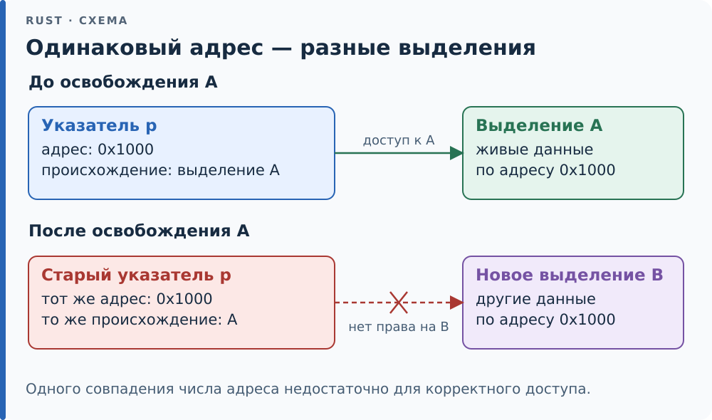

# 16.4. Provenance: адрес и право

У указателя в Rust есть не только адрес, но и **provenance** (происхождение указателя) — право
обращаться к определённому участку памяти. Два указателя с одинаковым
числовым адресом не равнозначны: один может иметь право на выделение,
другой — нет. Например, после освобождения буфера распределитель может
отдать тот же адрес новому буферу; старый указатель от этого не становится
пригодным для доступа к новому объекту. Меняя адрес, нужно сохранять
связь указателя с исходным выделением памяти.

<div class="diagram">



</div>

*Адрес может использоваться повторно, но связь указателя с прежним выделением не превращается в связь с новым.*

Это не педантизм: оптимизатор опирается на provenance, когда решает, что
две записи не мешают друг другу. Если бы «указатель — это просто адрес»,
такие выводы были бы незаконны.

## Строгий API

Строгий API отделяет адрес от provenance явно: `addr()` берёт адрес как
число, `with_addr()` ставит новый адрес на provenance существующего
указателя, `map_addr()` делает и то и другое. Классическое применение —
*тегированный указатель* (tagged pointer): тип выровнен, младшие биты
адреса свободны, в них прячут состояние.

```rust
{{#include ../../code/ch16/src/provenance.rs:tagged}}
```

Записать тег, снять его и обратиться к значению — право доступа всё время
идёт от исходного указателя, число адреса лишь посредник:

```rust
{{#include ../../code/ch16/src/provenance.rs:roundtrip}}
```

Это проходит и `-Zmiri-strict-provenance` — режим Miri, который не
поддерживает восстановление указателя из целого через exposed provenance.
Для `map_addr` исходный указатель сохранён явно, поэтому такого
восстановления не требуется.

<div class="box hood">

**Под капотом.** Модель provenance нужна и компилятору, и верификатору.
Для CHERI и подобных архитектур указатель физически несёт тег-способность
в дополнительных битах, и подделать его из числа нельзя на уровне
железа — строгий provenance описывает ровно эту дисциплину переносимо.
На обычном x86 битов-способностей нет, но правило то же: `expose_provenance`
/ `with_exposed_provenance` помечают, где право «засветили» через число,
и оптимизатор обязан это учесть.

</div>

<div class="box trap">

**Ловушка — два режима provenance.** `ptr as usize as *mut T` не означает
автоматического UB. Такие приведения используют *exposed provenance*:
выставляют происхождение наружу и при обратном приведении подбирают ранее
выставленное происхождение. Явные аналоги — `expose_provenance` и
`with_exposed_provenance_mut`. Одного совпадения адресов всё равно
недостаточно: нужен живой объект и подходящие права доступа.

Строгий API (`addr`, `with_addr`, `map_addr`) передаёт происхождение явно
и удобнее для проверки. Отказ строгого режима Miri от целочисленного
приведения сам по себе не доказывает UB во всех режимах. Подробнее — в
[документации std::ptr](https://doc.rust-lang.org/std/ptr/index.html#exposed-provenance).

</div>
