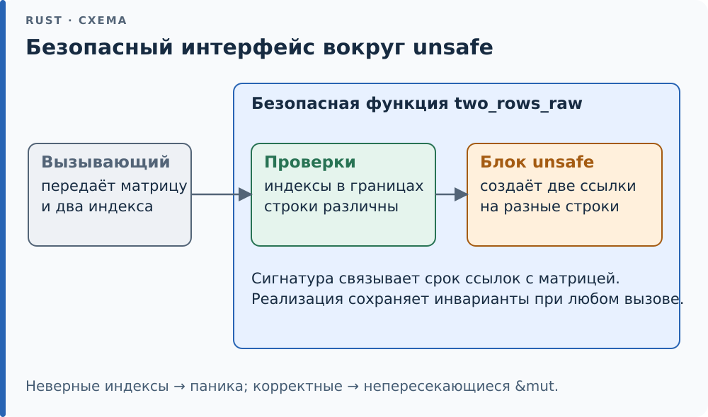

# 16.6. Запереть unsafe за безопасным API

Главный приём всей главы: необходимый `unsafe` запирают в короткой
функции, чья сигнатура безопасна, а предусловия проверены внутри. Тогда
весь остальной код остаётся безопасным, а область, которую нужно
доказывать и брать на ревью, — несколько строк. Такой API *корректен*
(sound, свойство — soundness): никакой безопасный код, как бы он его ни
вызывал, не получит UB. Если получить может, API некорректен (unsound),
даже когда все нынешние вызовы в программе правильны.

<div class="diagram">



</div>

*Снаружи действует безопасный контракт; его доказательство сосредоточено внутри функции.*

Пример — выдать две разные строки матрицы как непересекающиеся `&mut`.
Заёмщик не даст взять `&mut` на `m[a]` и `m[b]` по индексам одновременно,
хотя если строки разные, память они не делят. Это и есть случай, где
`unsafe` оправдан: факт из предметной области (строки различны) система
типов сама вывести не может.

Через `split_at_mut` — вовсе без сырых указателей, стандартная функция
уже заперла `unsafe` за себя:

```rust
{{#include ../../code/ch16/src/safe_api.rs:split}}
```

Когда `split_at_mut` не подходит (например, строки нужно вернуть в
исходном порядке), берут сырые указатели — и `unsafe` умещается в три
строки, предусловия проверены `assert`-ами выше:

```rust
{{#include ../../code/ch16/src/safe_api.rs:split_raw}}
```

Разберём `// SAFETY`-комментарий ко второму варианту по частям — это
образец того, что обязан доказывать каждый `unsafe`-блок:

- `a != b` — отрезки `[a·cols, a·cols+cols)` и `[b·cols, …)` не
  пересекаются, значит две `&mut` не алиасят (правило из
  [16.5](05-models.md));
- оба в границах — это гарантирует `assert` на `(a.max(b)+1)·cols <=
  m.len()`;
- `base` жив на время заёма `m` — ссылки не переживут `m`, их [время
  жизни][g-lifetime] связано с ним сигнатурой.

Снаружи обе функции безопасны: неверные индексы ловит `assert` (паника,
не UB), а корректные дают непересекающиеся ссылки. Проверяет это общий
тест под Miri в обеих моделях — задача B требует того же от
`split_first_mut`.

<div class="box trick">

**Приём.** Предусловие, которое нельзя проверить в release без затрат,
ставят через `debug_assert!`: под тестом и Miri оно ловит нарушение, в
release исчезает. В `get_unchecked` из [16.1](01-abilities.md) так и
сделано — `debug_assert!(i < slice.len())` рядом с `// SAFETY`. Это не
замена доказательству, а страховка на время отладки.

</div>

<div class="box check">

**Проверь себя.** Почему сигнатура `two_rows_raw` возвращает именно
`(&mut [T], &mut [T])` со временем жизни, связанным с `&mut m`, а не
`*mut T`? Потому что безопасность и состоит в том, чтобы отдать наружу
проверяемые заёмом ссылки: вызывающий не сможет использовать их после
того, как `m` изменится или исчезнет. Верни функция сырые указатели —
бремя доказательства переехало бы к каждому вызывающему, и `unsafe`
перестал бы быть заперт.

</div>

<!-- Ссылки на глоссарий (приложение F); обновляет tools/check-terms.py --refs -->
[g-lifetime]: ../appendix-f.md#lifetime "Время жизни (lifetime): Имя для участка программы, на котором ссылка действительна: 'a в &'a str."
