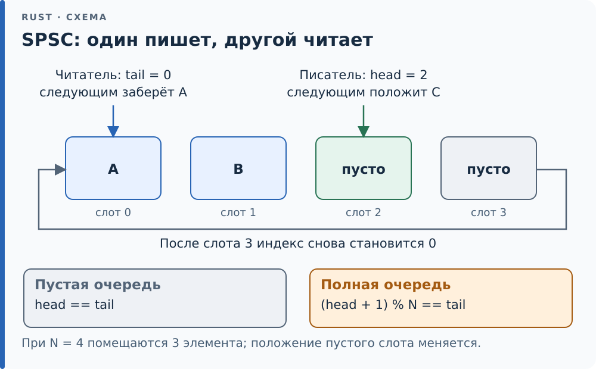

# 21.5. Lock-free: кольцевой буфер SPSC

Теперь соберём из атомиков что-то полезное — очередь *без замка*
(lock-free): ни один поток не ждёт другого. Самый частый и самый дешёвый
случай: **один писатель, один читатель** (SPSC, single-producer
single-consumer). Канонический пример на микроконтроллере — передать
данные из обработчика прерывания в основной цикл: прерывание кладёт,
`main` забирает, и городить мьютекс (который прерывание всё равно не имеет
права ждать) здесь незачем.

## Устройство

Кольцевой буфер на `N` слотов: писатель двигает индекс `head`, читатель —
`tail`. Вся синхронизация — на атомарных `load`/`store` индексов, **без
read-modify-write**. Это принципиально: по [21.4](04-hardware.md) атомарный
RMW недоступен на Cortex-M0, а load/store есть везде — поэтому очередь
работает и на самом младшем ядре.

```rust
{{#include ../../code/ch21/src/spsc.rs:spsc}}
```

Слоты — `UnsafeCell<MaybeUninit<T>>`: ячейка, потому что писать в них будем
через общую `&`-ссылку ([14](../ch14/index.md)), и `MaybeUninit`, потому что
пустые слоты не инициализированы ([17](../ch17/index.md)). [`Sync`][g-send-sync] ставим
вручную: компилятор сам его не выведет из-за `UnsafeCell`, а мы знаем
инвариант — писатель и читатель трогают *разные* слоты.

Например, при `N = 4` пустая очередь имеет `head = tail = 0`.
После `push(A)` значение A лежит в слоте 0, `head = 1`, `tail = 0`.
После `pop()` читатель забирает A и устанавливает `tail = 1`: индексы
снова равны, очередь пуста. Дойдя до края массива, индекс возвращается к
нулю, поэтому очередь называется кольцевой. Писатель публикует новый
`head` только после записи значения, иначе читатель увидел бы готовый
индекс при ещё незаполненном слоте.

<div class="diagram">



</div>

*Каждый индекс двигает только своя сторона; после последнего слота отсчёт продолжается с нуля.*

## Почему `push` и `pop` — `unsafe fn`

Инвариант держится, только пока писатель один и читатель один. `Sync`
разрешает делить `&Spsc` между любым числом потоков, методы берут `&self`,
и ничто в типах не мешает двум потокам звать `push` одновременно. Оба
прочтут один `head` и запишут в один слот — гонка данных, а один из
элементов пропадёт. Два `pop` сразу прочтут один слот, и у значения станет
два [владельца][g-ownership]: для `Box` первый освободит память, второй получит висячий
указатель. Miri ловит оба случая: на двух писателях — «Data race detected»
на записи в слот, на двух читателях — «dangling box (use-after-free)».

Приём из [16.6](../ch16/06-api.md) — проверить предусловие внутри и
оставить сигнатуру безопасной — здесь не работает: «вызывает только один
поток» изнутри не проверить без атомарного RMW, а его на Cortex-M0 нет.
Поэтому условие уходит к вызывающему: раздел `# Safety` у `push` и `pop`,
а у каждого вызова — `unsafe` с обоснованием
([16.1](../ch16/01-abilities.md)), как в прошивках главы 27: «писатель —
только обработчик прерывания, читатель — только `main`». Проверить то же
типами можно иначе: метод `split(&mut self)` отдаёт по ручке писателю и
читателю, и у каждой нет `Clone` — так устроена очередь `heapless::spsc`.
Плата — `&mut` на очередь на всё время работы, то есть в прошивке
`static mut` или ячейка, которую заполняют при запуске.

## Где здесь happens-before

Главное — в двух строчках `push` и `pop`. Писатель сначала пишет элемент в
слот (обычной записью через указатель), затем `head.store(next, Release)`.
Читатель `head.load(Acquire)` — и если увидел новый `head`, то по
happens-before ([21.2](02-ordering.md)) видит и записанный элемент. Release
публикует «слот готов», Acquire это ловит. Симметрично `tail` сообщает
писателю, что слот освобождён, — поэтому `push` читает `tail` с `Acquire`,
а `pop` пишет его с `Release`.

Свой же индекс каждый читает с `Relaxed`: `head` меняет только писатель, и
относительно самого себя порядок не нужен. Это и есть «минимальный
доказуемо верный порядок» из [21.3](03-fences.md): три `Relaxed` там, где
хватает атомарности, и по одному Acquire/Release ровно на точках передачи.

<div class="box trap">

**Ловушка — один слот всегда пуст.** Буфер на `N` слотов вмещает `N − 1`
элемент. Будь иначе, «полна» и «пуста» выглядели бы одинаково: `head ==
tail`. Поэтому «полна» — это `(head + 1) % N == tail`, и один слот
намеренно жертвуется. Отсюда же `assert!(N >= 2)` в `new`: при `N == 1`
очередь не вместила бы ничего.

</div>

<div class="box hood">

**Под капотом.** `Drop` вручную «осушает» очередь: `MaybeUninit` не роняет
своё содержимое сам ([17](../ch17/index.md)), поэтому непрочитанные
элементы пришлось бы утечь. `drop` зовёт `pop`, пока очередь не опустеет:
`assume_init_read` выполняется ровно для заполненных слотов, тех, что
между `tail` и `head`. Это единственное место, где важно, что в пустых
слотах лежит мусор, а не `T`: их мы не трогаем. Обосновать `unsafe` здесь
проще всего: `&mut self` значит, что других ссылок на очередь, а с ними и
других читателей нет.

</div>

<div class="box check">

**Проверка.** `single_thread_fifo` проверяет логику FIFO и границы «полна/
пуста» на одном потоке — и под Miri, которая сверяет работу с
`UnsafeCell<MaybeUninit<T>>` (нет чтения неинициализированного слота, нет
нарушения [алиасинга][g-aliasing]). `producer_consumer_preserve_order` гоняет 200 000
элементов через очередь на 64 слота двумя потоками и требует строгого
порядка — на нём бы вылезла ошибка в Acquire/Release (под Miri помечен
`ignore`: миллионы операций по его планировщику идут слишком долго). Под
Miri вместо него идёт `producer_consumer_small` — 20 элементов через 4
слота. Miri моделирует слабую память и ловит гонки данных: замените в
`push` `Release` на `Relaxed` — и он сообщит «Data race detected» на слоте,
тогда как стресс-прогон на x86 такую ошибку не покажет. Чередования Miri
выбирает по зерну планировщика, поэтому малый тест полезно прогнать с
несколькими (`-Zmiri-many-seeds`, [31.6](../ch31/06-miri-loom.md)).

</div>

<!-- Ссылки на глоссарий (приложение F); обновляет tools/check-terms.py --refs -->
[g-aliasing]: ../appendix-f.md#aliasing "Алиасинг (aliasing): Два пути к одной памяти: два указателя, ссылка и указатель."
[g-ownership]: ../appendix-f.md#ownership "Владение (ownership): Правило Rust: у каждого значения ровно один владелец — переменная, поле или элемент коллекции, — и он отвечает за уничтожение значения."
[g-send-sync]: ../appendix-f.md#send-sync "Send, Sync: Автотрейты потокобезопасности."
