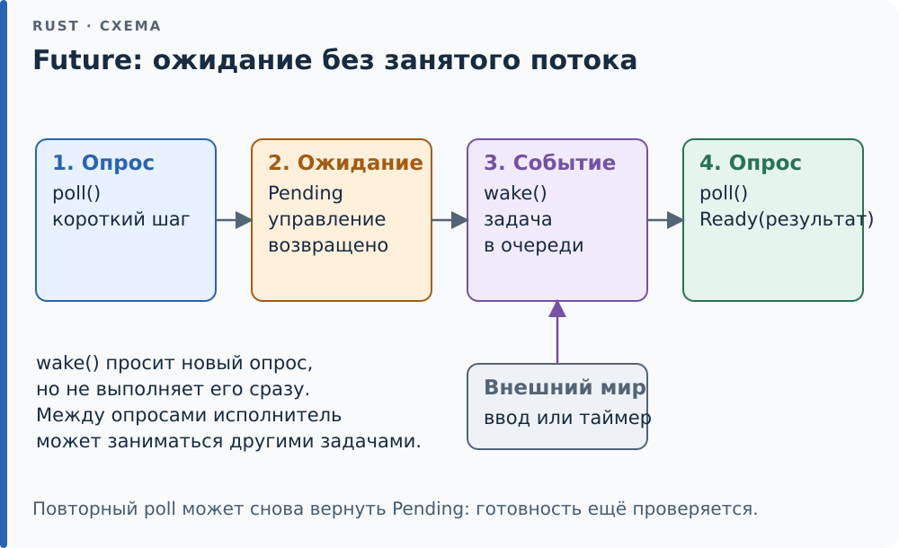

# 22.1. Future, poll и Waker

Вся асинхронность Rust стоит на одном [трейте][g-trait] из `core`:

```rust,ignore
pub trait Future {
    type Output;
    fn poll(self: Pin<&mut Self>, cx: &mut Context<'_>) -> Poll<Self::Output>;
}

pub enum Poll<T> { Ready(T), Pending }
```

*Future* — значение, которое можно *опрашивать*. `poll` либо отдаёт
`Poll::Ready(результат)`, либо `Poll::Pending` — «ещё не готово».
Само наличие future не запускает выполнение её тела: оно продвигается
при опросах. Уже запущенная внешняя операция, например ввод-вывод, при этом
может продолжаться между опросами. Это отличается от `std::thread::spawn`,
где поток начинает выполнять переданное тело после запуска. Про `Pin<&mut Self>` — в
[22.3](03-pin.md); пока достаточно знать, что для обычных типов это просто
`&mut Self`.

Прочитаем сигнатуру по частям. `Self` — тип конкретной future;
`Self::Output` — тип её будущего результата. `&mut Context<'_>` позволяет
получить будильник текущей задачи, а `Poll<Self::Output>` — перечисление
с двумя вариантами: результата ещё нет или он уже получен. `Pin<&mut Self>`
даёт изменяемый доступ с дополнительным условием о неподвижности значения.
Это не отдельный поток и не место для хранения результата в ОС.

<div class="diagram">



</div>

*Между опросами задача не удерживает поток ожиданием внутри poll.*

## Контракт Pending

Вернув `Pending`, future берёт на себя обязательство: *когда появится смысл
опросить её снова, она даст об этом знать*. Для этого `Context` несёт
*будильник* (waker) — значение типа `Waker`, ручку «разбуди задачу».
Простейшая future, которая сама себя будит:

```rust
{{#include ../../code/ch22/src/future.rs:countdown}}
```

`CountDown::new(3)` готова на четвёртом опросе: при первых трёх вызовах
счётчик ожидания уменьшается и возвращается `Pending`; при следующем
ожидать уже нечего и возвращается `Ready`. Возвращая `Pending`, метод
`poll` завершает текущий вызов и отдаёт управление вызывающему. Он не
остаётся ждать внутри функции. Каждый раз, возвращая
`Pending`, она вызывает `wake_by_ref` — «опроси меня ещё раз». Настоящая
future (чтение сокета, таймер) будит не сразу, а когда событие произошло;
но правило то же: `Pending` без пробуждения — задача уснула навсегда. Этот
случай увидим в [22.4](04-executor.md), где исполнитель честно сообщает о
таких «потерянных» задачах.

Ещё одна мелочь контракта: после `Ready` future опрашивать нельзя. Это не
неопределённое поведение — просто результат не определён (автомат из
[22.2](02-state.md) [запаникует][g-panic], `CountDown` вернёт число снова). Для
безопасного повторного опроса есть `FutureExt::fuse` в [крейте][g-crate] futures.

Минимальная точка приостановки — `yield_now`: один раз `Pending` с
немедленным пробуждением, затем `Ready`. На ней async fn превращается в
автомат с состояниями ([22.2](02-state.md)):

```rust
{{#include ../../code/ch22/src/future.rs:yield_now}}
```

## Кто опрашивает: от noop до block_on

Опросить future может кто угодно, у кого есть `Context`. Проще всего —
будильником, который ничего не делает (`Waker::noop`, стабилен с 1.85):

```rust
{{#include ../../code/ch22/src/future.rs:poll_count}}
```

Это честно только для future, которые будят себя сами: `poll_to_end`
крутится, не дожидаясь пробуждений. Для таймера, который будит через
20 мс, он сжёг бы процессор. Настоящий исполнитель между опросами *спит*, а
`wake` его будит. На потоке ОС это пара `thread::park` / `Thread::unpark`:

```rust
{{#include ../../code/ch22/src/future.rs:block_on}}
```

Трейт `std::task::Wake` — удобный способ сделать будильник из `Arc`:
реализуете `wake`, а `Waker::from(Arc<W>)` построит всё остальное.
`park` вправе проснуться и без `unpark` (ложное пробуждение), поэтому после
него — просто ещё один опрос: лишний `poll` безвреден, контракт требует
лишь, чтобы нужный не потерялся.

<div class="box c">

**Как в C.** Колбэк с контекстом: `void (*cb)(void *ctx)` плюс `ctx`.
`Waker` — тот же колбэк, только с типизированной таблицей операций
(клонировать, разбудить, освободить) и без соблазна вызвать его после
освобождения `ctx`: время жизни данных будильника — забота его [владельца][g-ownership],
а не того, кто будит.

</div>

## Будильник через границу потоков

Будит задачу обычно *кто-то другой*: поток таймера, обработчик прерывания,
реактор ввода-вывода. Поэтому `Waker` обязан быть `Send + Sync` — это
записано в самом типе. Таймер на отдельном потоке:

```rust
{{#include ../../code/ch22/src/future.rs:thread_timer}}
```

future при каждом `Pending` сохраняет *текущий* будильник: между опросами
задачу могли передать другому исполнителю, и старый будильник разбудил бы
не того. Поток таймера по истечении срока ставит `done` и будит.

<div class="box trap">

**Ловушка — потерянное пробуждение.** Проверка `done` и запоминание
будильника идут под одним замком. Разнесите их — «проверил: не готово»,
отпустил замок, «запомнил будильник» — и поток таймера может успеть между
ними: поставит `done`, будильника не найдёт, никого не разбудит. Задача
уснёт, хотя готова. Это та же гонка «проверить и уснуть», что у условных
переменных и у `wfi` на микроконтроллере ([22.6](06-bare.md)): условие и
регистрация ожидания должны быть атомарны относительно того, кто будит.

</div>

<div class="box hood">

**Под капотом.** `Waker` — два слова: указатель на данные и указатель на
`RawWakerVTable` из четырёх функций (`clone`, `wake`, `wake_by_ref`,
`drop`). Это ручной `dyn`-объект ([11](../ch11/index.md)) без кучи и без
`dyn`: так его можно построить и в [`no_std`][g-no-std], вообще без `Arc`. Для `Arc<W:
Wake>` таблицу генерирует std — `clone` увеличивает счётчик ссылок, `drop`
уменьшает. Своя таблица на статическом флаге — в [22.6](06-bare.md).

</div>

<div class="box check">

**Проверка.** `countdown_needs_n_plus_one_polls`: `CountDown::new(3)` готова
за 4 опроса и возвращает 4. `yield_now_pends_exactly_once`: ровно два
опроса. `block_on_drives_self_waking_future` гоняет `CountDown` через
`park`/`unpark`. `thread_timer_wakes_from_another_thread`: `block_on` таймера
на 20 мс возвращается не раньше, чем через 20 мс, — будильник пришёл из
чужого потока (под Miri этот тест помечен `ignore`: поток со сном там идёт
долго; остальные проходят Miri в обеих моделях).

</div>

<!-- Ссылки на глоссарий (приложение F); обновляет tools/check-terms.py --refs -->
[g-crate]: ../appendix-f.md#crate "Крейт (crate): Единица компиляции Rust: одно дерево модулей, один вызов rustc, один результат — библиотека или программа."
[g-no-std]: ../appendix-f.md#no-std "no_std: Атрибут крейта #![no_std]: крейт пользуется только core (и, если нужно, alloc), без стандартной библиотеки ОС."
[g-ownership]: ../appendix-f.md#ownership "Владение (ownership): Правило Rust: у каждого значения ровно один владелец — переменная, поле или элемент коллекции, — и он отвечает за уничтожение значения."
[g-panic]: ../appendix-f.md#panic "Паника (panic): Аварийная реакция на ошибку в самой программе: индекс за границей, unwrap на None, переполнение в отладочной сборке."
[g-trait]: ../appendix-f.md#trait "Трейт (trait): Набор методов, типов и констант, которые тип обязуется предоставить: Drop, Iterator, Copy."
