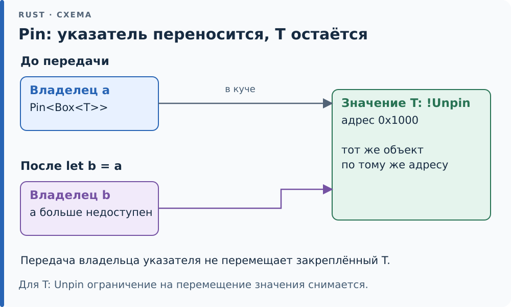

# 22.3. Pin и Unpin

В [22.2](02-state.md) автомат хранил *значения* живых переменных. Но что,
если через `.await` живёт ещё и *ссылка* на такую переменную?

```rust,ignore
async {
    let v = [1u8, 2, 3];
    let r = &v;            // ссылка на переменную автомата
    yield_now().await;     // и v, и r — в одном состоянии
    r.len()
}
```

В состоянии лежат и `v`, и `r`, а `r` указывает на `v` — то есть *внутрь
самого автомата*. Пока автомат не двигается, всё хорошо. [Переместите][g-move] его
(передайте по значению, положите в `Vec`, который перераспределится), и `r`
продолжит смотреть на старое место. В обычном коде такую структуру
заимствования не дали бы собрать; автоматы async нуждаются в ней
постоянно. Нужен способ пообещать: *после первого опроса это значение не
сдвинется*.

Различайте перемещение владельца и перемещение размещённого значения.
При передаче `Box<T>` в другую переменную меняется владелец указателя,
а `T` остаётся по прежнему адресу в куче. При переносе самого `T` адрес
его полей может измениться. Закрепление защищает именно `T`, а не имя
переменной и не байты указателя на него.

<div class="diagram">



</div>

*На двух этапах показан один объект в куче: меняется владелец указателя на него.*

## Самоссылка руками

Та же ситуация без async — *самоссылающаяся* структура (self-referential
struct) с указателем на собственное поле:

```rust
{{#include ../../code/ch22/src/pin.rs:selfref}}
```

`init` и `first` принимают `self` только закреплённым: `Pin<&mut Self>` и
`Pin<&Self>`. После `init` указатель смотрит на `data` *этого* экземпляра, и
пока он закреплён, так и будет. Тот же тип без `Pin` легко сломать:

```rust
{{#include ../../code/ch22/src/pin.rs:unpinned}}
```

```rust
{{#include ../../code/ch22/src/pin.rs:moved}}
```

`Box::new(u)` копирует байты `u` по новому адресу, а `ptr` по-прежнему
смотрит в старый слот стека. Разыменовать его — неопределённое поведение;
тест только сравнивает адреса. Ровно так сломался бы перемещённый автомат.

## Что обещает Pin

`Pin<P>` — обёртка над указателем (`&mut T`, `Box<T>`) для *закрепления*
(pinning) значения. Она обещает: *значение `T` не будет перемещено, пока
не будет уничтожено*. Обещание держится тем, что безопасный код не может
получить из `Pin<&mut T>` обычный `&mut T`: через `&mut` работают
`mem::swap`, `mem::replace` и перемещение `*r`. [Модуль][g-module]
`code/ch22/src/pin.rs` закрепляет это [doc-тестами][g-doctest] `compile_fail` с кодами
ошибок:

- `let moved: SelfRef = *p;` из закреплённого — E0507 (нельзя переместить
  из-под указателя);
- `mem::swap(&mut *a, &mut *b)` двух закреплённых — E0596 (`&mut` из `Pin`
  для `!Unpin`-типа не взять);
- `Pin::new(&mut s)` для `SelfRef` — E0277 (безопасный конструктор только
  для `Unpin`);
- async-блок с `let r = &v;` через `.await`, переданный туда, где нужен
  `Unpin`, — E0277: автомат async закреплять обязательно.

Последний пункт — главное. **`Unpin`** — автоматический трейт: «этому типу
закрепление ничего не обещает, его можно двигать и закреплённым». Почти
все типы `Unpin`: числа, `Vec`, `Box`, `String`, любые структуры из них.
Запись `!Unpin` в объяснениях означает «тип не реализует `Unpin`»;
это не синтаксис обычного ограничения [обобщённой][g-generic] функции.
Не `Unpin` — автоматы async и типы с полем `PhantomPinned`, как `SelfRef`.
Автомат `!Unpin` всегда, даже пустой `async {}` или `async fn h() {}`
(rustc 1.97: «`{async block}` cannot be unpinned», E0277): решение принято
для всех сразу, а не по тому, есть ли в конкретном теле самоссылка. Для `Unpin`-типов `Pin` прозрачен:
`Pin::new` безопасен, `Pin::get_mut` отдаёт `&mut T`. Поэтому `CountDown`
из [22.1](01-future.md) просто пишет `self.polls += 1`.

<div class="box hood">

**Под капотом.** `Pin` — `#[repr(transparent)]`, размер ровно указателя:
никакой проверки в рантайме нет, вся гарантия — в том, какие методы
доступны безопасному коду. Единственный выход к `&mut T` для `!Unpin` —
`unsafe fn get_unchecked_mut`, и контракт у него один: не перемещать
значение через полученную ссылку. Так и устроен `SelfRef::init`: он
записывает поле `ptr`, но не двигает `*this`.

</div>

## Где закрепить

Сообщение E0277 «cannot be unpinned» часто встречается при попытке
сделать `Pin::new(&mut future)` для результата `async fn`. Оно не
требует убрать `.await` или написать `unsafe`. Безопасный `Pin::new`
годится для `Unpin`, а у автомата такого свойства нет. Выберите место,
где автомат останется до уничтожения: стек через `pin!` или кучу через
`Box::pin`.

Например, здесь новая future закрепляется на стеке и опрашивается один
раз. Этот async-блок сразу готов, поэтому пустого будильника достаточно:

```rust
use std::future::Future;
use std::task::{Context, Poll, Waker};

fn main() {
    let future = async { 42 };
    let mut future = std::pin::pin!(future);
    let mut cx = Context::from_waker(Waker::noop());
    assert_eq!(future.as_mut().poll(&mut cx), Poll::Ready(42));
}
```

`as_mut()` даёт короткое повторное заимствование `Pin<&mut F>` для
вызова `poll`; сам автомат остаётся на месте. Закрепление не запускает
future: работу в этом примере выполняет последующий вызов `poll`.
Различие между перемещением указателя и его содержимого подробнее
описано в [документации `std::pin`](https://doc.rust-lang.org/std/pin/index.html).

Закрепить значение можно тремя способами, и все они встречаются в главе:

- `pin!(fut)` (стабилен с 1.68) — на стеке: значение переезжает в скрытую
  переменную, а наружу выходит `Pin<&mut F>`, так что сдвинуть его уже
  нечем. Так закрепляют `block_on` и `poll_to_end`;
- `Box::pin(fut)` — в куче: двигается `Box` (указатель), а значение лежит
  на месте. Так хранит задачи исполнитель ([22.4](04-executor.md)); тест
  `box_pin_pins_on_heap` проверяет, что адрес значения после перемещения
  `Box` не изменился;
- `Pin::static_mut(&'static mut T)` — для значения, которое живёт вечно:
  [арена][g-arena] задач в задаче D1 ([22.7](07-tasks.md)).

К обещанию «не двигать» прилагается второе — *гарантия drop* (drop
guarantee): память закреплённого значения нельзя переиспользовать, не
вызвав его [деструктор][g-destructor]. На ней держатся *навязчивые списки* (intrusive
lists) ожидания в рантаймах: узел-будильник живёт внутри future и вписан в
общий список, а `Drop` future обязан его оттуда вынуть до того, как память
освободится.

<div class="box c">

**Как в C.** Навязчивые списки ядра Linux (`struct list_head`, вшитый в
структуру) — та же самоссылка: соседи хранят адреса узла. Сделать `memcpy`
такой структуры и забыть исправить соседей — классическая порча памяти, от
которой в C защищает только дисциплина. `Pin` переносит эту дисциплину в
типы: закреплённое не скопируют ни `memcpy`-подобный `mem::swap`, ни
передача по значению.

</div>

<div class="box trick">

**Трюк — `Pin<&mut F>` всегда `Unpin`.** Указатель можно двигать, даже
когда значение под ним двигать нельзя. Поэтому [комбинаторы][g-combinator], которым удобно
требовать `F: Unpin` (как `select` и `join` в [22.5](05-cancel.md)),
принимают и `!Unpin`-future: закрепите её `pin!` и передайте `Pin<&mut F>`.
Доступ к полям закреплённой структуры («проекцию») безопасно генерирует
крейт pin-project: он следит, чтобы из `Pin<&mut Struct>` получался
`Pin<&mut Field>` только для полей, которые сами должны быть закреплены.

</div>

<div class="box check">

**Проверка.** `pinned_self_reference_stays_valid`: закреплённая `SelfRef`
после `init` смотрит на себя и читает свой первый байт.
`moving_breaks_self_reference`: `Unpinned` после переезда в `Box` смотрит
мимо. `box_pin_pins_on_heap`: адрес закреплённого в куче значения не
меняется при перемещении `Box`. Четыре doc-теста `compile_fail`: коды
ошибок сверяет nightly [rustdoc][g-rustdoc] (задание miri в CI), stable проверяет, что
примеры не компилируются. Под Miri в обеих моделях алиасинга тесты
проходят — `get_unchecked_mut` в `init` им не нарушает правил.

</div>

<!-- Ссылки на глоссарий (приложение F); обновляет tools/check-terms.py --refs -->
[g-arena]: ../appendix-f.md#arena "Арена (arena): Хранилище, в котором все узлы структуры лежат в одном векторе, а связи между ними — индексы, а не ссылки."
[g-combinator]: ../appendix-f.md#combinator "Комбинатор (combinator): Метод или функция, которая строит новое вычисление из готовых, не разбирая значение вручную: map, and_then, ok_or у Option и Result, адаптеры итераторов, all, any и not в условиях cfg."
[g-destructor]: ../appendix-f.md#destructor "Деструктор (destructor): Код, который выполняется при уничтожении значения: реализация трейта Drop, затем уничтожение полей."
[g-doctest]: ../appendix-f.md#doctest "doc-тест (doctest): Пример кода в документирующем комментарии ///, который cargo test собирает и запускает как тест."
[g-generic]: ../appendix-f.md#generic "Обобщение (generic): Функция или тип с параметрами-типами: fn max(a: T, b: T) -> T."
[g-module]: ../appendix-f.md#module "Модуль (module): Пространство имён внутри крейта со своими правилами видимости: объявляется словом mod, с телом в скобках или в отдельном файле."
[g-move]: ../appendix-f.md#move "Перемещение (move): Передача владения значением: после let b = a владеет b, а a больше использовать нельзя."
[g-rustdoc]: ../appendix-f.md#rustdoc "rustdoc: Генератор документации Rust: собирает HTML из комментариев /// (cargo doc) и запускает doc-тесты."
