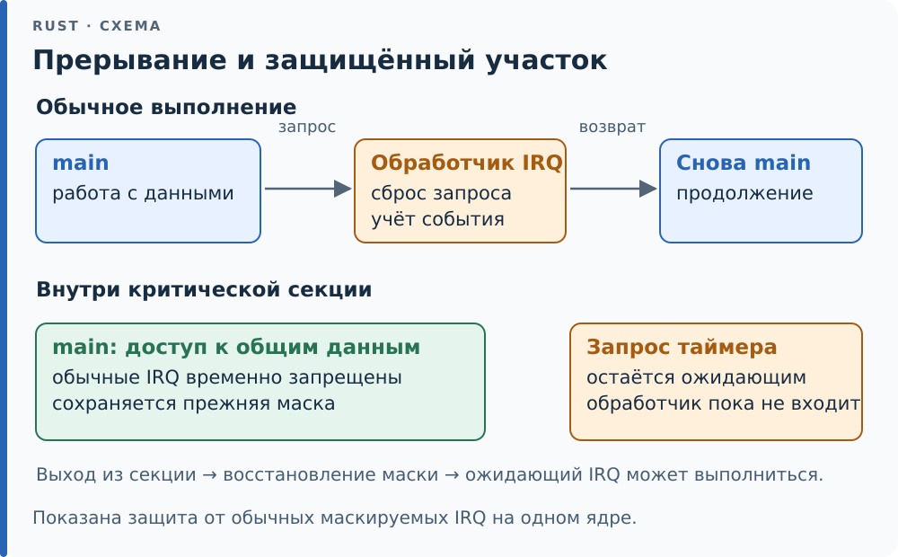

# 27.6. Прерывания и общее состояние

## Обработчик без аргументов

Обработчик прерывания — функция без аргументов, которую зовёт процессор.
Всё, что ему нужно, он находит в `static`. Таймеру TIMER0 нужно сбрасывать
запрос в своём регистре ICR — значит, обработчику нужен сам таймер, а
`main` нужен счётчик тиков. В C это две глобальные переменные с
`volatile`. В Rust `static` должен быть [`Sync`][g-send-sync], а изменяемый `static mut`
— `unsafe` при каждом обращении, а ссылки на него в [edition][g-edition] 2024 по
умолчанию запрещает проверка компилятора `static_mut_refs`. Остаются типы,
которые сами отвечают за доступ:

```rust
{{#include ../../firmware/ch27-irq/src/main.rs:shared}}
```

Каждый слой `Mutex<RefCell<Option<Timer0>>>` решает свою задачу:

Читайте этот тип снаружи внутрь: «доступ только в критической секции;
внутри можно временно получить изменяемое [заимствование][g-borrowing]; таймер может
ещё отсутствовать». Критическая секция здесь — короткий участок,
в котором реализация critical-section для одного ядра временно
запрещает обычные прерывания. Поэтому обработчик таймера не может
вмешаться в работу с общими данными. Такая защита нужна даже на одном
ядре: прерывание может остановить `main` между двумя операциями.

<div class="diagram">



</div>

*Один процессор не устраняет возможность вмешательства: обработчик
может выполниться между двумя шагами основного кода.*

- `critical_section::Mutex<T>` — `Sync`, если `T: Send`, но отдаёт `&T`
  только в обмен на `CriticalSection` — значение, которое существует
  лишь внутри `critical_section::with`. Вне секции содержимого не
  достать;
- `RefCell` превращает `&` в `&mut` на время [заимствования][g-borrowing], с проверкой
  при выполнении: внутри секции нужен `&mut Timer0`, чтобы вызвать
  `clear`;
- `Option` — потому что таймер появляется в `main`, после
  `Peripherals::take()`, а `static` нужно значение при компиляции.
  До переезда там `None`.

Счётчику достаточно атомика: одно слово, `fetch_add` без критической
секции.

Почему нельзя оставить только `RefCell`? Она сама по себе не `Sync` и
не годится для такого `static`. Причина видна и по возможному выполнению:
представьте, что `main` уже получил `RefMut`, и ровно в этот момент вошёл
обработчик. Его `borrow_mut` не подождёт освобождения: `RefCell` обнаружит второе
изменяемое заимствование и вызовет панику. Критическая секция закрывает
это окно: обработчик выполнится после выхода из неё, когда `RefMut`
уже уничтожен.

И обратная сторона: одна критическая секция не разрешает получить два
`&mut` на одно значение внутри неё. Вызвать функцию, которая снова
заимствует тот же таймер, можно и без прерывания. `RefCell` проверяет
эту вторую, независимую обязанность. Поэтому слои отвечают на разные
вопросы: `Mutex` — «когда допустим доступ?», `RefCell` — «нет ли уже
действующего несовместимого заимствования?», `Option` — «таймер уже
подготовлен?». При выходе из секции восстанавливается прежняя маска
прерываний, а при выходе из области `RefMut` заканчивается заимствование.

## Переезд в обработчик

```rust
{{#include ../../firmware/ch27-irq/src/main.rs:move}}
```

```console
$ cd firmware && cargo run --release -p ch27-irq
TIMER0: 10 тиков по 10 мс, main спал в wfi
```

Порядок важен: таймер кладётся в `TIMER0` *до* того, как
`NVIC::unmask` разрешит прерывание. Наоборот — и первый вход в
обработчик найдёт `None`, не сбросит запрос, и процессор будет входить
в обработчик снова и снова — как в опыте ниже. Комментарий `SAFETY` у
`unmask` говорит именно об этом.

Во что это обходится, видно в дизассемблере обработчика:

```text
<TIMER0A>:
	push	{r7, lr}
	mov	r7, sp
	movw	r0, #0x0
	mrs	r1, primask
	cpsid i
	movt	r0, #0x2000
	ldr	r2, [r0, #0xc]
	cbnz	r2, 0x174 <TIMER0A+0x48>
	mov.w	r2, #0xffffffff
	str	r2, [r0, #0xc]
	ldrb	r2, [r0]
	cbz	r2, 0x15c <TIMER0A+0x30>
	movs	r2, #0x24
	movs	r3, #0x1
	movt	r2, #0x4003
	str	r3, [r2]
	ldr	r2, [r0, #0xc]
	adds	r2, #0x1
	b	0x15e <TIMER0A+0x32>
	movs	r2, #0x0
	str	r2, [r0, #0xc]
	msr	primask, r1
	ldrex	r1, [r0, #0x8]
	adds	r1, #0x1
	strex	r2, r1, [r0, #0x8]
	cmp	r2, #0x0
	bne	0x164 <TIMER0A+0x38>
	pop	{r7, pc}
	bl	0xf56 <…panic_already_borrowed>
```

- `mrs r1, primask; cpsid i` … `msr primask, r1` — критическая секция.
  Реализация для одного ядра из cortex-m (возможность
  `critical-section-single-core`) запоминает PRIMASK и восстанавливает
  его, а не разрешает прерывания безусловно: вложенная секция не
  откроет внешнюю;
- `ldr [r0, #0xc]`, `cbnz` — счётчик заимствований `RefCell`. Если
  ячейка уже занята — паника `already_borrowed`. Компилятор не может
  доказать, что это невозможно, и путь паники остаётся;
- `ldrb [r0]`, `cbz` — проверка `Option`. `Timer0` нулевого размера, и
  `Option<Timer0>` — один байт-признак;
- `str` в 0x4003_0024 — ICR таймера, это и есть `t.clear()`;
- [`ldrex`][g-exclusive-access], `strex`, `bne` — `fetch_add` атомика: загрузка с меткой
  исключительного доступа, запись, которая не удаётся, если между ними
  кто-то вмешался, и повтор.

<div class="box trap">

**Ловушка.** На Cortex-M0 (thumbv6m-none-eabi) `ldrex` и `strex` нет. У
атомиков там есть `load` и `store`, а `fetch_add`, `swap` и
`compare_exchange` не компилируются: таких методов для этой [цели][g-target] нет.
Счётчик, общий с обработчиком, на M0 — либо `Mutex<Cell<u32>>` под
критической секцией, либо крейт portable-atomic, который делает то же
самое за вас. Поэтому очередь [SPSC][g-spsc] из главы 21 обходится одними `load`
и `store` — и работает на всех трёх целях книги.

</div>

## Забытый сброс запроса

Прерывание таймера — запрос *по уровню*: бит «досчитал» в регистре RIS
держится, пока его не сбросят записью в ICR. NVIC видит запрос и после
выхода из обработчика входит в него снова. Обработчик однократного
таймера TIMER1, который забыл про `clear`:

```rust
{{#include ../../firmware/ch27-irq/src/main.rs:forgot}}
```

```rust
{{#include ../../firmware/ch27-irq/src/main.rs:forgot_run}}
```

```console
TIMER1 досчитал один раз, а обработчик вошёл 1000 раз; запрос всё ещё висит: true
```

Таймер досчитал один раз, а обработчик вошёл тысячу и вошёл бы ещё,
если бы не маска. `main` всё это время не выполнялся: процессор выходил
из обработчика и по цепочке (раздел [27.2](02-nvic.md)) входил в него
же. На плате это выглядит как зависание прошивки — при работающем,
казалось бы, коде. Сброс запроса HAL оставляет обработчику:

```rust
{{#include ../../code/ch27-hal/src/timer.rs:clear}}
```

## Длинная критическая секция

Пока прерывания запрещены, запросы ждут. Но ждут они в одном бите
NVIC «ожидает», и пять событий, пришедших за время ожидания, — это
один вход в обработчик:

```rust
{{#include ../../firmware/ch27-irq/src/main.rs:long_cs}}
```

```console
SysTick: 5 периодов в критической секции, обработчик вошёл 1 раз
```

Внутри секции счётчик SysTick обнулился пять раз — это видно по флагу
COUNTFLAG, — а обработчик после секции вошёл один раз. Четыре тика
потеряны: счётчик времени по SysTick отстал на 4 мс. Правило отсюда:
критическая секция короче самого короткого периода прерываний, которые
она запрещает. Отладочный `hprintln!` внутри `critical_section::with` —
частая причина таких потерь: [semihosting][g-semihosting] останавливает ядро, пока
отладчик не ответит, и на плате это миллисекунды.

## Сон и пропущенное пробуждение

`wfi` — «ждать прерывания»: процессор спит, пока не придёт запрос. Цикл
ожидания в `main` выше — проверка, потом `wfi`. Между ними есть окно:
если прерывание придёт после проверки, но до `wfi`, его обработчик
выполнится, а процессор уснёт до *следующего* прерывания. С таймером на
10 мс это стоит не больше одного периода. С событием, которое приходит
один раз, — например, байтом команды по UART, — прошивка уснёт с
необработанным байтом в очереди.

Окно закрывается тем, что `wfi` будит и запрос, который маска PRIMASK
не пускает в обработчик. Проверка и `wfi` — при запрещённых
прерываниях, обработчик — сразу после их разрешения. Так ждёт байта
консоль из задачи [27.C](10-tasks.md):

```rust
{{#include ../../firmware/ch27-tasks/src/bin/c_uart.rs:sleep}}
```

<div class="box c">

**Как в C.** `volatile uint32_t ticks;` и `__disable_irq()` /
`__enable_irq()` вокруг доступа к структуре. Две частые ошибки —
`__enable_irq()` в конце секции, которая открывает внешнюю секцию
раньше времени (правильно — сохранить `__get_PRIMASK()` и
восстановить), и `ticks++` из `main` при `volatile`: это чтение, `add`
и запись, и тик из прерывания между ними пропадёт. В Rust первое
решает `critical_section::with`, второе — `fetch_add`, а доступ к
структуре без секции не компилируется.

</div>

<div class="box hood">

**Под капотом.** Почему `strex` в `main` не удастся, если между `ldrex`
и `strex` выполнился обработчик? Ядро хранит локальный монитор
исключительного доступа, и ARMv7-M сбрасывает его при входе в
исключение и выходе из него. После возврата из обработчика `strex`
видит сброшенный монитор, возвращает 1, и цикл повторяет загрузку уже
с новым значением.

</div>

<div class="box check">

**Проверь себя.** Почему `TIMER0` нельзя объявить
`static TIMER0: Mutex<RefCell<Timer0>>` с таймером внутри сразу? Что
будет, если в обработчике `TIMER0A` вызвать `critical_section::with`
дважды, одну внутри другой, и в обеих взять `borrow_ref_mut`? Как
изменится вывод опыта с SysTick, если секция продлится 0,5 периода?

</div>

<!-- Ссылки на глоссарий (приложение F); обновляет tools/check-terms.py --refs -->
[g-borrowing]: ../appendix-f.md#borrowing "Заимствование (borrowing): Создание ссылки на значение без передачи владения: &x — разделяемое, &mut x — уникальное."
[g-edition]: ../appendix-f.md#edition "Редакция (edition): Версия правил языка, которую выбирает каждый крейт: 2015, 2018, 2021, 2024."
[g-exclusive-access]: ../appendix-f.md#exclusive-access "Эксклюзивный доступ (exclusive access): Пара инструкций ARM LDREX и STREX: первая читает слово и ставит адрес под наблюдение монитора, вторая пишет, только если с тех пор никто не писал по адресу и не было исключения."
[g-semihosting]: ../appendix-f.md#semihosting "Semihosting: Способ, которым прошивка просит отладчик выполнить ввод-вывод за неё: номер операции в r0, параметры в r1, затем bkpt 0xab."
[g-send-sync]: ../appendix-f.md#send-sync "Send, Sync: Автотрейты потокобезопасности."
[g-spsc]: ../appendix-f.md#spsc "SPSC (single-producer single-consumer): Очередь с одним писателем и одним читателем."
[g-target]: ../appendix-f.md#target "Цель (target): То, для чего генерируется код: архитектура, ОС и ABI, записанные в имени-триплете (thumbv7m-none-eabi)."
