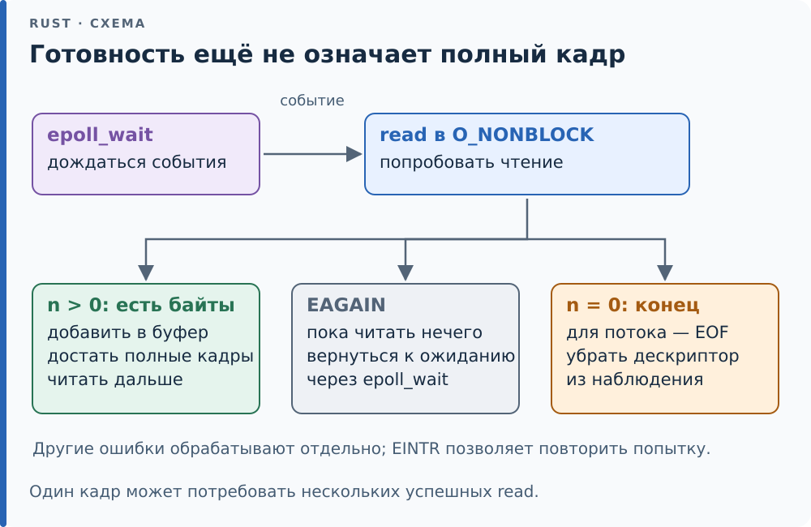

# 28.6. epoll и обзор io_uring

<div class="box ref">

**Справка: ожидание многих дескрипторов.** `select` и `poll` получают
список дескрипторов при каждом вызове: ядро проходит его целиком,
подписывает процесс на каждый и отписывает перед возвратом — O(n) на
вызов, сколько бы событий ни случилось. `epoll` делит это на два шага.
`epoll_ctl` один раз добавляет дескриптор в список интереса, который
живёт в ядре; ядро само кладёт его в список готовых, когда в нём
появляются данные. `epoll_wait` только забирает готовые — O(число
событий). Режимов два. **Уровневый** (level-triggered, по умолчанию):
дескриптор считается готовым, пока в нём есть непрочитанные данные, и
`epoll_wait` сообщит о нём снова и снова. **Фронтовой** (edge-triggered,
`EPOLLET`): событие — только когда данных стало больше, чем было.

</div>

## Цикл событий

Готовность — повод попробовать операцию, а не обещание получить
целое сообщение. Для устойчивого цикла событий дескриптор переводят
в неблокирующий режим: если данные уже забрал другой читатель,
`read` вернёт `EAGAIN`, и можно снова ждать готовности. Сам `epoll`
не включает этот режим. При успешном чтении тоже может прийти лишь
часть сообщения. Например, после прихода первых
двух байтов десятибайтового кадра канал уже может быть готов к чтению.
Нужно прочитать доступную часть, сохранить её и дождаться остальных
байтов. `epoll` сообщает, с каким источником можно продолжить работу;
границы кадров всё равно определяет код протокола.
Это различие и чтение до `EAGAIN` описаны в
[epoll(7)](https://man7.org/linux/man-pages/man7/epoll.7.html).

<div class="diagram">



</div>

*Событие сообщает, где попробовать чтение. Сборка целых кадров
остаётся отдельной задачей буфера и парсера.*

После события ориентируйтесь на результат самого `read`. Для канала
или потокового сокета и **непустого** буфера возможны разные исходы:

| Результат в rustix | Что он означает | Следующий шаг |
|---|---|---|
| `Ok(n)`, где `n > 0` | Получено ровно `n` байт; сообщение может быть ещё неполным | Передать `buf[..n]` накопителю; в `EPOLLET` продолжить чтение |
| `Err(Errno::AGAIN)` | Сейчас доступных байтов нет; это не конец потока | Сохранить накопленное и вернуться к ожиданию |
| `Ok(0)` | Поток закончился; новых байтов уже не будет | Завершить обработку источника и убрать его из `epoll` |
| `Err(Errno::INTR)` | Вызов прерван сигналом до получения байтов | Повторить чтение |
| Другая ошибка | Операция не удалась по иной причине | Обработать ошибку или завершить работу с источником |

У `EAGAIN` и конца потока одно внешнее сходство — новых байтов нет.
Но в первом случае ждём продолжения, а во втором ожидание уже не
поможет. Пустой буфер исключён из таблицы: запрос на чтение нуля байтов
сам по себе может вернуть 0, не означая конца потока. Эти исходы
описаны в [read(2)](https://man7.org/linux/man-pages/man2/read.2.html).

Один поток читает несколько каналов в том порядке, в каком приходят
данные:

```rust,ignore
{{#include ../../code/ch28/src/poll.rs:drain}}
```

Это упрощённый опыт: у каждого канала один читатель, используется
уровневый режим, на событие делается одно чтение. Для общего цикла с
неблокирующими источниками нужно также обработать `EAGAIN` и повторение
после `EINTR`, как в таблице выше; в режиме `EPOLLET` — читать до `EAGAIN`.

Каждому дескриптору при добавлении дано число — номер источника, — и
`epoll_wait` возвращает его в `ev.data`: по нему видно, чей это кусок.
Буфер событий — `Vec` с запасом ёмкости: `spare_capacity` из rustix
отдаёт ядру незаполненную часть и после вызова выставляет длину по
числу событий, без `unsafe` в нашем коде. Канал, писатель которого
закрыл свой конец, готов «навсегда»: `read` вернёт 0, это конец потока,
и дескриптор пора убрать из `epoll`.

`Errno::INTR` — не ошибка, а повод ждать снова: сигнал прерывает
`epoll_wait` и при `SA_RESTART` (ловушка раздела
[28.4](04-signals.md)). Без этой ветки тест ниже однажды упал в CI с
`Interrupted system call`.

Тест `drains_in_arrival_order` пишет в три канала в порядке 2, 0, 1 с
паузами по 30 мс, и куски приходят в том же порядке. Так устроен любой
цикл событий в Rust на Linux: [реактор][g-reactor] `mio`, на котором стоит tokio, —
это `epoll_wait`, после которого будятся [`Waker`][g-waker] тех задач, чьи
дескрипторы стали готовы (раздел [22.4](../ch22/04-executor.md)).

## Уровень и фронт

Сколько раз `epoll` сообщит о канале, где лежат 5 байт, если на каждое
событие читать по одному байту:

```rust,ignore
{{#include ../../code/ch28/src/poll.rs:edge}}
```

Тест `level_reports_until_empty_edge_reports_once`: в уровневом режиме
событий 5 — по одному на каждый байт, пока канал не опустел; во
фронтовом — 1. Новых данных после первого события не появилось, и
`epoll` молчит, хотя в канале ещё 4 байта.

<div class="box trap">

**Ловушка: фронтовой режим требует читать до EAGAIN.** С `EPOLLET`
событие на дескрипторе — обещание «появилось новое», а не «есть
непрочитанное». Прочитали часть — остаток будет лежать, пока не придут
следующие данные, а если не придут, — вечно. Правило: во фронтовом
режиме дескриптор неблокирующий (`O_NONBLOCK`), и на каждое событие
читать в цикле, пока `read` не вернёт `EAGAIN`. Иначе — блокирующий
`read` на опустевшем канале остановит весь цикл событий. mio
использует фронтовой режим ради того, чтобы не будить задачу на одни и
те же данные дважды, и поэтому все его дескрипторы неблокирующие.

</div>

## io_uring: обзор

`epoll` сообщает о готовности, а сам `read` — по-прежнему системный
вызов, на каждое событие. io_uring (ядро 5.1 и новее) переворачивает
схему: вместо «скажи, когда можно читать» — «прочитай и скажи, когда
прочитал». Процесс и ядро делят два кольца в общей памяти: очередь
запросов (SQ) и очередь завершений (CQ). Программа кладёт в SQ запросы
— `read` такого-то дескриптора в такой-то буфер, `write`, `accept`,
`fsync`, — и одним `io_uring_enter` отдаёт ядру сразу пачку; результаты
появляются в CQ. С `IORING_SETUP_SQPOLL` поток ядра сам следит за SQ, и
системных вызовов в установившемся режиме нет вовсе.

```rust,ignore
{{#include ../../code/ch28/src/poll.rs:uring}}
```

Тест `io_uring_rings_if_available` просит кольцо на 8 запросов: ядро
отвечает `sq_entries = 8` и `cq_entries = 16` — очередь завершений по
умолчанию вдвое длиннее, чтобы завершений от пачки запросов хватило
места. Если вызов запрещён — в контейнерах io_uring часто выключают
seccomp-профилем, — тест ничего не проверяет.

Для Rust у io_uring своя трудность, которой нет у `epoll`. Буфер
запроса `read` ядро пишет **после** того, как вызов вернулся, — когда
сочтёт нужным. Заимствование `&mut [u8]` выразить это не может: оно
кончается вместе с вызовом, а будущее (раздел [22.1](../ch22/01-future.md))
с таким заимствованием можно уничтожить до завершения запроса, и ядро
запишет в освобождённую память. Поэтому безопасные API поверх io_uring
(`tokio-uring`, `glommio`, `monoio`) **забирают буфер во владение**:
`read(buf: Vec<u8>)` возвращает его обратно вместе с результатом.
Отмена такого будущего не освобождает буфер, пока ядро не сообщило о
завершении. Крейт `io-uring` — низкоуровневый, и `push` запроса в нём —
`unsafe fn` ровно по этой причине.

<div class="box check">

**Проверь себя.**

1. Почему в `drain_all` после `read`, вернувшего 0, дескриптор надо
   удалить из `epoll`? Что будет, если этого не сделать, в уровневом
   режиме?
2. В `events_for_one_byte_reads` с `edge = true` после первого события
   допишите в канал ещё байт. Сколько событий насчитает функция?
3. Почему io_uring не помогает программе, которая делает один `read` в
   секунду?

</div>

<!-- Ссылки на глоссарий (приложение F); обновляет tools/check-terms.py --refs -->
[g-reactor]: ../appendix-f.md#reactor "Реактор (reactor): Часть асинхронного рантайма, которая ждёт событий внешнего мира — готовности сокета, таймера, прерывания — и будит задачи, которые их ждут."
[g-waker]: ../appendix-f.md#waker "Будильник (waker): Значение типа Waker из Context, через которое future просит исполнителя опросить её снова."
