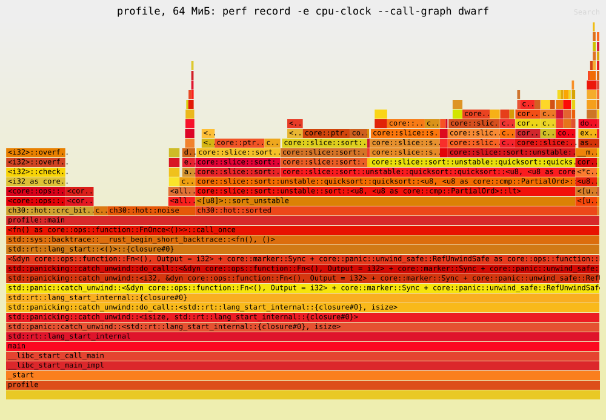

# 30.3. perf: счётчики, профиль, flamegraph

<div class="box ref">

**Справка: счётчики производительности.** В каждом ядре процессора есть
*PMU* (performance monitoring unit) — несколько счётчиков, которые ядро
ОС программирует на события: такты (`cycles`), выполненные инструкции
(`instructions`), промахи последнего уровня кэша (`cache-misses`),
неугаданные переходы (`branch-misses`) и сотни событий, специфичных
для модели. Отношение инструкций к тактам — **IPC** (instructions per
cycle) — первая цифра, по которой видно, упирается код в вычисления (IPC
3–4 на современном x86) или ждёт памяти (IPC меньше 1). Счётчиков меньше,
чем событий: если попросить больше, ядро считает их по очереди
(мультиплексирование) и масштабирует результат.

Виртуальной машине PMU должен дать гипервизор (vPMU), и дают его не
все: машина, на которой снята эта глава, — Firecracker без vPMU, ядро
при загрузке пишет «no PMU driver, software events only». Остаются
**программные события**, которые считает само ядро: `task-clock` —
время, которое поток провёл на процессоре; `page-faults`;
`context-switches`; `cpu-clock` — таймер, по которому можно снимать
выборки. Для профиля «где идёт время» их достаточно; для вопроса
«почему» (промахи кэша, переходы) в такой машине нужен симулятор —
cachegrind, раздел [30.4](04-cachegrind.md).

</div>

## perf_event_open своими руками

*`perf`* — не магия, а программа поверх одного системного вызова. Его
можно позвать и самому:

```rust,ignore
{{#include ../../code/ch30/src/perf_event.rs:attr}}
```

```rust,ignore
{{#include ../../code/ch30/src/perf_event.rs:event}}
```

```rust,ignore
{{#include ../../code/ch30/src/perf_event.rs:counter}}
```

Счётчик — дескриптор (раздел [28.2](../ch28/02-fds.md)): открыть
выключенным, обнулить, включить, выполнить работу, выключить, прочитать
восемь байт. `exclude_kernel` — считать только код пространства
пользователя: для этого хватает `kernel.perf_event_paranoid` не выше 2.
Ubuntu по умолчанию ставит 4, и тогда обычному пользователю — `EACCES`
на любое событие; CI главы перед тестами делает `sudo sysctl -w
kernel.perf_event_paranoid=1`.

Программа пробует все семь событий: сумму квадратов миллиона чисел и,
для страничных сбоев, — тысячу свежих страниц:

```rust,ignore
{{#include ../../code/ch30/src/perf_event.rs:touch}}
```

```rust,ignore
{{#include ../../code/ch30/src/bin/counters.rs:main}}
```

```console
$ cargo run -q -p ch30 --release --bin counters
          cycles: не открыт: No such file or directory (os error 2)
    instructions: не открыт: No such file or directory (os error 2)
    cache-misses: не открыт: No such file or directory (os error 2)
   branch-misses: не открыт: No such file or directory (os error 2)
      task-clock: 1300426
     page-faults: 1000
context-switches: 0
```

Аппаратных событий нет — `ENOENT`, «такого события нет»: PMU не
найден. `task-clock` — 1,3 мс на миллион чисел, как и ждали по 0,38 нс
на число с поправкой на холодные данные. Страничных сбоев — ровно
тысяча: `MADV_NOHUGEPAGE` запретил [огромные страницы][g-huge-page], и каждая запись в
новую страницу — один сбой (раздел [28.5](../ch28/05-mmap.md)). Тесты
`page_faults_one_per_fresh_page` и `task_clock_counts_nanoseconds`
проверяют это для своих счётчиков, `observed_hardware_counters_or_enoent`
— что аппаратные события либо считают, либо отказывают одной из ошибок
«нет поддержки».

## perf stat

Программа для профилировщика — три фазы разной цены над 64 МиБ
псевдослучайных байт:

```rust,ignore
{{#include ../../code/ch30/src/hot.rs:noise}}
```

```rust,ignore
{{#include ../../code/ch30/src/hot.rs:crc}}
```

```rust,ignore
{{#include ../../code/ch30/src/hot.rs:histogram}}
```

```rust,ignore
{{#include ../../code/ch30/src/hot.rs:sorted}}
```

```rust,ignore
{{#include ../../code/ch30/src/bin/profile.rs:main}}
```

В Ubuntu `/usr/bin/perf` — обёртка, которая ищет perf для текущего
ядра и, не найдя пакета для ядра 6.18, отказывается работать. Сам perf
из пакета `linux-tools-generic` с этим ядром работает; ниже `perf` —
это `/usr/lib/linux-tools/6.8.0-147-generic/perf`, тесты берут путь из
переменной `PERF`.

```console
$ cargo build -q -p ch30 --release --bin profile
$ perf stat -e task-clock,page-faults,context-switches,cycles,instructions target/release/profile
64 МиБ: crc b9c5, нулей 262605, медиана 127

 Performance counter stats for 'target/release/profile':

           1266.83 msec task-clock                       #    0.999 CPUs utilized
             32845      page-faults                      #   25.927 K/sec
                 1      context-switches                 #    0.789 /sec
   <not supported>      cycles
   <not supported>      instructions

       1.267637819 seconds time elapsed

       1.172778000 seconds user
       0.087486000 seconds sys
```

32 845 сбоев — 64 МиБ данных и 64 МиБ отсортированной копии, по сбою на
каждую из 2 × 16 384 страниц, и 77 на запуск программы. 87 мс в ядре —
это они: обнулить и отобразить 128 МиБ. Тест
`perf_stat_page_faults_of_profile` проверяет то же на 16 МиБ.

Сбой на каждые 4 КиБ — потому что THP здесь в режиме `madvise`, а
`profile` огромных страниц не просит (раздел [28.5](../ch28/05-mmap.md)).
В режиме `always` — так настроена, например, машина CI книги — те же
вектора легли бы на страницы по 2 МиБ, по сбою на каждую. Поэтому тесты
запускают программы главы так, как сняты числа текста, — с запретом THP
для процесса. Запрет `PR_SET_THP_DISABLE` наследуется через fork и exec
и действует и на программу, которую запускает perf:

```rust,ignore
{{#include ../../code/ch30/tests/common/mod.rs:no_thp}}
```

## perf record: где идёт время

Профиль собирают выборочно: через небольшие интервалы инструмент
запоминает место исполнения. Если из тысячи таких наблюдений около
шестисот попали в сортировку, считаем её долю времени примерно равной
60 %. Это оценка по выборкам, а не точный секундомер вокруг каждого
вызова. При чтении таблицы сначала ищите большую долю, затем
разбирайтесь, какую работу выполняет соответствующая функция.

`perf record` просит ядро прерывать программу по таймеру `cpu-clock`
(по умолчанию 4000 раз в секунду) и записывать, где она была:

```console
$ perf record -q -e cpu-clock target/release/profile
$ perf report --stdio --no-children | llvm-cxxfilt
# Samples: 4K of event 'cpu-clock'
# Event count (approx.): 1197250000
#
# Overhead  Command  Shared Object         Symbol
    60.03%  profile  profile               [.] core::slice::sort::unstable::quicksort::quicksort::<u8, <u8 as core::cmp::PartialOrd>::lt>
    18.02%  profile  profile               [.] ch30::hot::crc_bitwise
    12.65%  profile  profile               [.] ch30::hot::noise
     2.38%  profile  profile               [.] ch30::hot::histogram
     1.92%  profile  [kernel.kallsyms]     [k] do_user_addr_fault
     0.92%  profile  [kernel.kallsyms]     [k] _raw_spin_lock
     0.48%  profile  [kernel.kallsyms]     [k] clear_page_erms
     0.46%  profile  libc.so.6             [.] __memmove_avx512_unaligned_erms
```

Шесть десятых времени — сортировка, а не CRC, на которую подумал бы
каждый, кто видел восемь шагов на байт. `llvm-cxxfilt` в конвейере не для
красоты: rustc 1.97 декорирует имена по схеме v0 (`_RNvNtCs…`), а perf 6.8
из Ubuntu их не разбирает. Бывает perf, который разбирает их сам, —
например, perf 6.17 на машине CI книги, и тогда `llvm-cxxfilt` в конвейере
ничего не меняет, а тесты узнают функцию в обоих видах.
`llvm-cxxfilt` разбирает (здесь — из LLVM 18; его же даёт `rustup
component add llvm-tools`); `c++filt` из binutils 2.42 тоже, но
оставляет в имени хеш крейта.

Видны функции, а не строки: `crc_bitwise`, `histogram` и `sorted`
помечены `#[inline(never)]`, иначе их тела растворились бы в `main` и
отчёт сказал бы «95 % — main». `noise` — без атрибута, но это функция
другого крейта без `#[inline]`, и LLVM её не встроил (раздел
[30.5](05-compiler.md) разберёт, когда встраивает).

<div class="box trick">

**Трюк: `#[inline(never)]` для читаемого профиля.** Атрибут на
функциях-фазах стоит почти ничего — один вызов на фазу, — а профиль
сразу говорит языком программы. Для горячих маленьких функций он,
наоборот, вреден: вызов на каждой итерации мешает векторизации, и
профиль покажет уже не ту программу. Ставьте его на границах фаз, а
не внутри циклов.

</div>

## Стеки: указатель кадра или DWARF

Плоский профиль говорит, *где* время, но не *кто* туда пришёл:
сортировку могли звать из десяти мест. Стек каждой выборки perf
собирает одним из двух способов. `-g` идёт по цепочке указателей кадра
`rbp`:

```console
$ perf record -q -e cpu-clock -g target/release/profile
$ perf report --stdio --children | llvm-cxxfilt
    58.70%    58.70%  profile  profile               [.] core::slice::sort::unstable::quicksort::quicksort::<u8, <u8 as core::cmp::PartialOrd>::lt>
    25.53%     0.00%  profile  profile               [.] _start
    25.53%     0.00%  profile  libc.so.6             [.] __libc_start_main@@GLIBC_2.34
    25.53%     0.00%  profile  profile               [.] main
    18.47%    18.47%  profile  profile               [.] ch30::hot::crc_bitwise
    15.41%     0.00%  profile  [unknown]             [.] 0x8b48fb894820ec83
    15.41%    12.62%  profile  profile               [.] ch30::hot::noise
```

Первая колонка — включающее время (сама функция и всё, что она
вызвала), вторая — собственное. До `main` дошли стеки только четверти
выборок, у сортировки вызывающих нет вовсе, а `noise` «вызвана» из
адреса `0x8b48fb894820ec83` — это не адрес, а байты кода, прочитанные
как адрес. rustc на x86-64 Linux по умолчанию не держит указатель
кадра: `rbp` — обычный регистр, и цепочки нет. Два выхода.

**DWARF.** `--call-graph dwarf` копирует в каждую выборку верхушку стека
(8 КиБ) и регистры, а `perf report` [раскручивает][g-unwinding] стек по таблицам
`.eh_frame` — тем же, по которым идёт раскрутка паники:

```console
$ perf record -q -e cpu-clock --call-graph dwarf target/release/profile
$ perf report --stdio --children | llvm-cxxfilt | grep -E 'ch30::|profile::main|quicksort::<'
    99.87%     0.00%  profile  profile               [.] profile::main
    67.64%     0.00%  profile  profile               [.] ch30::hot::sorted
    64.01%    63.89%  profile  profile               [.] core::slice::sort::unstable::quicksort::quicksort::<u8, <u8 as core::cmp::PartialOrd>::lt>
    14.80%    12.64%  profile  profile               [.] ch30::hot::noise
    14.72%    14.72%  profile  profile               [.] ch30::hot::crc_bitwise
     2.33%     2.33%  profile  profile               [.] ch30::hot::histogram
```

Теперь 99,9 % выборок под `main`, и видно, что `sorted` целиком — 67,6 %:
сортировка и копирование входа (`to_vec`). Цена — объём: `perf.data` —
44 МБ против 0,4 МБ с `-g`, и `perf report` заметно медленнее.

**Указатель кадра.** `RUSTFLAGS="-C force-frame-pointers=yes"` заставляет
rustc держать `rbp` во всём, что он компилирует, — в нашем коде и в
обобщённом коде std, который конкретизируется у нас (сортировка):

```console
$ RUSTFLAGS="-C force-frame-pointers=yes" cargo build -q -p ch30 --release --bin profile --target-dir target/fp
$ perf record -q -e cpu-clock -g target/fp/release/profile
$ perf report --stdio --children | llvm-cxxfilt | grep -E 'ch30::|profile::main|quicksort::<'
    99.88%     0.00%  profile  profile               [.] profile::main
    63.79%     0.00%  profile  profile               [.] ch30::hot::sorted
    63.78%    63.64%  profile  profile               [.] core::slice::sort::unstable::quicksort::quicksort::<u8, <u8 as core::cmp::PartialOrd>::lt>
    15.52%    15.52%  profile  profile               [.] ch30::hot::crc_bitwise
    14.00%    11.74%  profile  profile               [.] ch30::hot::noise
     2.85%     2.85%  profile  profile               [.] ch30::hot::histogram
```

Стеки полные, файл — 0,9 МБ. Цена — у самой программы: она теряет
регистр общего назначения и платит парой инструкций за каждый вызов,
поэтому такую сборку держат отдельно от той, что мерят.

Тест `perf_record_finds_sort_hottest` записывает профиль с DWARF и
проверяет: в стеках больше половины выборок есть `sorted`, гистограмма
дешевле и CRC, и шума.

<div class="box trap">

**Ловушка: perf без libunwind и rust-lld.** Если в профиле с DWARF у
сортировки снова нет вызывающих, а `sorted` набирает пару процентов,
посмотрите `perf version --build-options`. В свежих исходниках perf
libunwind выключена по умолчанию (`libunwind: [ OFF ]` с подсказкой
«Deprecated, use LIBUNWIND=1»), и стек по DWARF раскручивает libdw.
Так собран, например, perf 6.17 из Ubuntu для ядер azure; на машине CI
книги он стоит рядом с perf 6.8. Адрес загрузки программы perf
сообщает libdw как начало отображения кода минус его смещение в файле.
Это верно, когда адрес сегмента кода равен смещению, — так раскладывает
GNU ld. А rustc 1.97 на x86-64 Linux линкует своим rust-lld, и тот
кладёт сегмент на страницу дальше:

```console
$ readelf -lW target/release/profile | grep 'R E'
  LOAD           0x013960 0x0000000000014960 0x0000000000014960 0x03f030 0x03f030 R E 0x1000
```

Правила `.eh_frame` libdw ищет на 4 КиБ раньше настоящего адреса. Для
сортировки она находит правила `main` ([CFA][g-cfa-cfi] = `rsp+16` вместо
`rsp+160`) и читает адрес возврата не оттуда: стек кончается мусорным
«вызывающим», например `main_arena+0x5f` — адресом в данных libc. Ту же
ошибку в пути libunwind исправили в 2022 году; путь libdw считает адрес
по-старому. Выходов три: perf с libunwind (perf 6.8 из
`linux-tools-generic`), указатель кадра с `-g` или сборка системным
компоновщиком:

```console
$ RUSTFLAGS="-C linker-features=-lld" cargo build -q -p ch30 --release --bin profile --target-dir target/ld
$ readelf -lW target/ld/release/profile | grep 'R E'
  LOAD           0x005000 0x0000000000005000 0x0000000000005000 0x03f33d 0x03f33d R E 0x1000
```

С такой сборкой perf 6.17 находит `sorted` в 60–63 % стеков. Тест
`perf_record_finds_sort_hottest` с perf без libunwind сначала
убеждается, что стеки сортировки оборваны все до одного, и повторяет
опыт на сборке GNU ld.

</div>

## flamegraph

Стеки удобнее читать картинкой — *flamegraph* (flame graph). Утилиты
inferno (порт скриптов FlameGraph Брендана Грегга на Rust,
`cargo install inferno`) сворачивают стеки `perf script` и рисуют SVG:

```console
$ perf script -F comm,pid,tid,time,event,ip,sym,dso | llvm-cxxfilt \
    | inferno-collapse-perf | inferno-flamegraph > flamegraph.svg
```



По горизонтали — доля выборок (не время по порядку!), по вертикали —
глубина стека, внизу `_start`, вверху листья. Ширина полосы — включающее
время функции: `sorted` занимает две трети ширины, над ней —
сортировка и `to_vec`; `noise` и `crc_bitwise` — по седьмой части,
`histogram` — узкая полоска. `-F` без `symoff` нужен, чтобы
`llvm-cxxfilt` видел имя отдельным словом, а не `_RNv…+0x1f`. Готовая
обёртка над всем этим — `cargo flamegraph` (крейт flamegraph): он сам
собирает release, зовёт perf и рисует.

## perf annotate: что внутри горячей функции

Восемь шагов на байт у CRC, а занимает она меньше сортировки. Почему —
видно в аннотации, где выборки разложены по инструкциям:

```console
$ perf annotate --stdio -M intel --no-source _RNvNtCs67eQXqKoQEU_4ch303hot11crc_bitwise
    0.00 :   150a0:  lea    rdx,[rip+0xffffffffffff42c9]        # 9370 <GCC_except_table142+0x17a4>
    0.00 :   150a7:  nop    WORD PTR [rax+rax*1+0x0]
    0.00 :   150b0:  mov    r8d,eax
    0.00 :   150b3:  shl    r8d,0x8
    4.52 :   150b7:  shr    eax,0x8
    1.97 :   150ba:  xor    al,BYTE PTR [rdi]
    4.63 :   150bc:  movzx  eax,al
    6.03 :   150bf:  movzx  eax,WORD PTR [rdx+rax*2]
   26.54 :   150c3:  xor    r8d,eax
    4.52 :   150c6:  shl    eax,0x8
    0.46 :   150c9:  shr    r8d,0x8
    5.68 :   150cd:  xor    r8b,BYTE PTR [rdi+0x1]
    6.03 :   150d1:  movzx  r8d,r8b
    5.56 :   150d5:  xor    ax,WORD PTR [rdx+r8*2]
   34.07 :   150da:  add    rdi,0x2
    0.00 :   150de:  add    rcx,0xfffffffffffffffe
    0.00 :   150e2:  jne    150b0 <ch30::hot::crc_bitwise+0x30>
```

Имя функции perf принимает декорированным — таким, каким он его знает;
хеш крейта (`Cs67eQXqKoQEU`) у вашей сборки другой, его видно в
`perf report` без `llvm-cxxfilt`.

Восьми шагов нет. LLVM распознал побитовую CRC и заменил её таблицей
на 256 значений `u16` по адресу `0x9370` (`movzx eax, WORD PTR
[rdx+rax*2]`) — тем самым алгоритмом, который в C пишут руками. Цикл
развёрнут вдвое: два байта, два чтения таблицы, 15 инструкций за
оборот. Имя рядом с адресом — `GCC_except_table142+0x17a4` — perf
подобрал по ближайшему символу; у таблицы символа нет, и имя ничего не
значит. Тест `rustc_crc_bitwise_became_a_table` проверяет, что в теле
два чтения таблицы и один цикл.

Проценты стоят не на загрузках, а на инструкциях *после* них: 26,5 % на
`xor` после чтения таблицы, 34 % на `add` после второго. Это смещение
(skid): прерывание таймера приходит, когда процессор уже на следующих
инструкциях, а виновата медленная предыдущая. С аппаратными событиями и
точным режимом (`cycles:pp`, PEBS у Intel) смещение меньше; с
`cpu-clock` его не убрать — читать аннотацию надо с поправкой на
инструкцию-другую.

<div class="box trap">

**Ловушка: исходник рядом с ассемблером.** Без `--no-source` perf
вставляет строки исходника по отладочной информации — для этого в
корневом `Cargo.toml` у release стоит `debug = true`. Но после
оптимизации инструкции [горячего цикла][g-hot-path] принадлежат встроенному коду std:

```text
         : 38    pub const fn overflowing_add(self, rhs: Self) -> (Self, bool) {
         : 39    let (a, b) = intrinsics::add_with_overflow(self as $ActualT, rhs as $ActualT);
    0.00 :   150b0:  mov    r8d,eax
```

Над чтением таблицы CRC — строка из `overflowing_add`, над
инкрементом указателя — `intrinsics::offset`. Строки исходника своей
функции в такой аннотации надо искать, а не ждать.

</div>

<div class="box c">

**Как в C.** Всё это работает и для C: perf не знает языка. Отличий
два. GCC и clang на x86-64 по умолчанию тоже не держат указатель кадра
(`-fomit-frame-pointer` входит в `-O1`), и выход тот же:
`-fno-omit-frame-pointer` или `--call-graph dwarf`. А gprof, привычный
по учебникам, требует пересборки с `-pg`, считает вызовы
инструментированием, а время — выборками только по своему коду: время в
библиотеках и в ядре он не видит. perf видит всё, включая ядро
(`[k] do_user_addr_fault` выше), и пересборки не требует.

</div>

<div class="box check">

**Проверь себя.** 1. В плоском профиле `noise` — 12,65 % собственного
времени, в профиле с DWARF — 14,8 % включающего. Что входит в разницу?
2. Почему у `crc_bitwise` собственное время равно включающему, а у
`sorted` собственное — ноль?

</div>

<!-- Ссылки на глоссарий (приложение F); обновляет tools/check-terms.py --refs -->
[g-cfa-cfi]: ../appendix-f.md#cfa-cfi "CFA, CFI (Canonical Frame Address, Call Frame Information): CFA — значение указателя стека до инструкции вызова функции, точка отсчёта её кадра."
[g-hot-path]: ../appendix-f.md#hot-path "Горячий и холодный путь (hot path, cold path): Горячий — код, который выполняется почти всегда: тело цикла, частая ветка; от его скорости зависит скорость программы."
[g-huge-page]: ../appendix-f.md#huge-page "Огромная страница (huge page): Страница памяти больше обычной, на x86-64 — 2 МиБ (запись на уровне PMD) или 1 ГиБ."
[g-unwinding]: ../appendix-f.md#unwinding "Раскрутка стека (unwinding): Снятие кадров стека по одному после паники с вызовом деструкторов живых значений."
