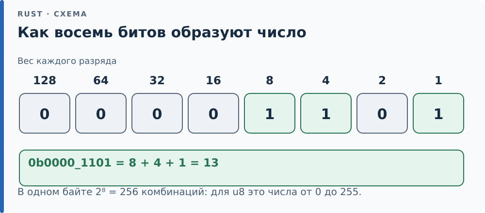
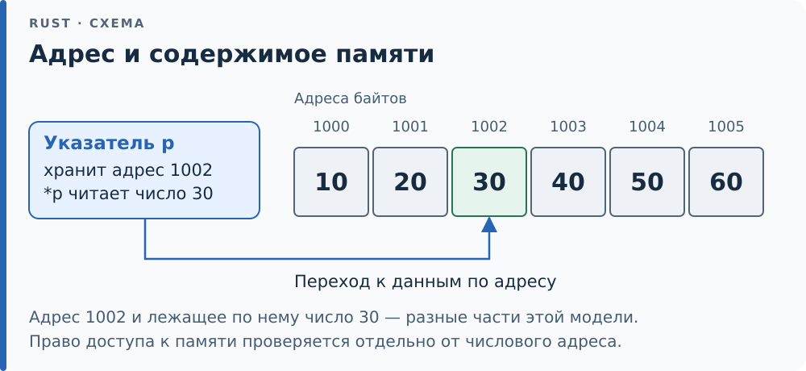
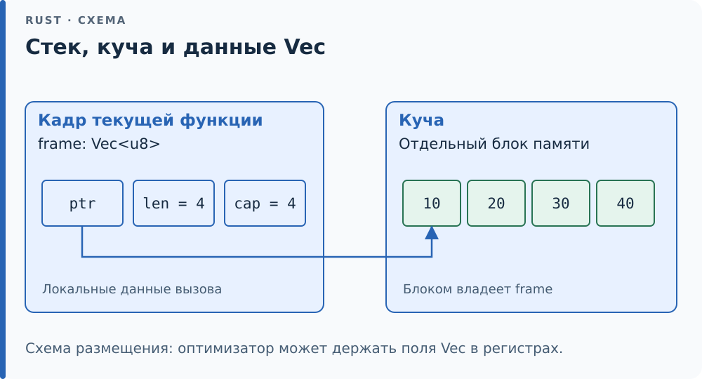
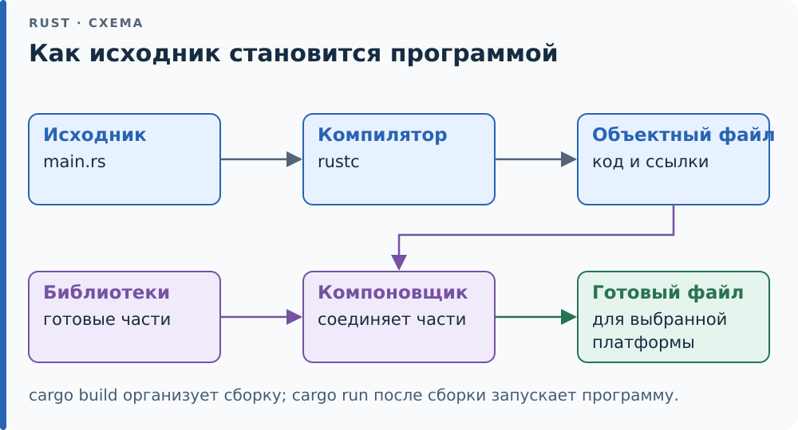
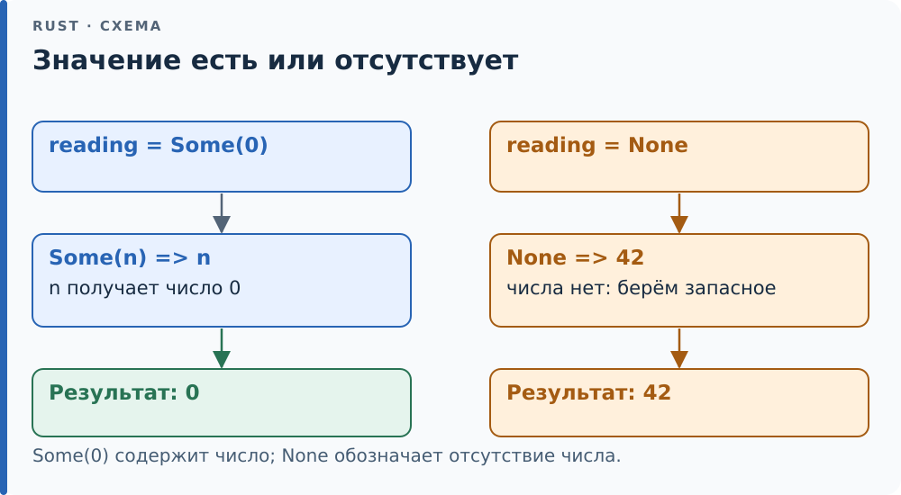

# Перед началом: основы и обозначения

Для книги достаточно уметь читать небольшую функцию с переменными,
условиями и циклами. Уверенное знание C, ассемблера и устройства ОС
поможет, но пробелы можно восполнить по ходу чтения. Этот раздел даёт
опору для первых глав; к нему можно возвращаться по ссылкам.

## Биты, байты и числа

**Бит** (bit) — двоичная цифра: 0 или 1. **Байт** (byte) в Rust состоит
из восьми битов. Из двух значений каждого бита получаются 2⁸ = 256
разных комбинаций байта. Если считать их беззнаковыми числами, это
диапазон от 0 до 255: ноль тоже занимает одну комбинацию.

Записи `13`, `0b0000_1101` и `0x0D` обозначают одно число в десятичной,
двоичной и шестнадцатеричной системах. После `0x` одна цифра обозначает
четыре бита: `A` = 10, …, `F` = 15. Поэтому `0xFF` = 15 × 16 + 15 = 255.
Подчёркивания в числе помогают читать запись и не меняют значение.
Младшие биты находятся справа: в `0b0000_1101` крайний правый бит
имеет вес 1, следующий — 2, затем 4, 8 и так далее.

<div class="diagram">



</div>

*Каждая единица добавляет вес своего разряда. Нулевые разряды в сумму не входят.*

`u8` — беззнаковое целое из восьми битов, `i8` — знаковое. Одни и те же
восемь битов могут обозначать разные числа в зависимости от типа:
`0xFF_u8` — 255, а все единицы в `i8` обозначают −1. Откуда берётся
такое представление отрицательных чисел, разобрано в [1.1](ch01/01-integers.md).
Размер в байтах и диапазон чисел — разные вопросы: два типа одинакового
размера могут разрешать разные значения.

## Память, адрес и указатель

Для первых примеров представляйте память как ряд пронумерованных
ячеек по одному байту. **Адрес** (memory address) — номер такой ячейки;
значение из нескольких байтов занимает несколько соседних адресов.
Не каждый адрес доступен программе: часть памяти ей не принадлежит,
а на микроконтроллере часть адресов соответствует устройствам.

**Указатель** (pointer) позволяет обратиться к данным по адресу.
**Разыменование** (dereference) — получение доступа к данным, на которые
он указывает: в записи `*p` звёздочка обозначает именно это действие.
Число, похожее на адрес, само по себе ещё не даёт права читать память.
Правила безопасных ссылок разбирает [глава 4](ch04/index.md), а [сырых
указателей][g-raw-pointer] — [глава 17](ch17/index.md).

Полезно различать три вещи: сам указатель, адрес в нём и данные по
этому адресу. Копирование указателя не создаёт второй экземпляр данных.
Если два указателя смотрят в один байт, изменение байта видно через оба.
Если память освободили, оставшийся указатель не сохраняет её живой.

<div class="diagram">



</div>

*Следуйте по стрелке от адреса в указателе к данным. Другой указатель на тот же адрес увидит ту же ячейку.*

**Выравнивание** (alignment) задаёт, каким адресам разрешено быть началом
значения. При выравнивании 4 подходят адреса 0, 4, 8, 12 и далее,
а 1 или 6 не подходят. Это требование к адресу, а не число байтов,
которые «добавляются перед каждым значением». Пустые промежутки между
полями структуры могут понадобиться именно ради выравнивания; расчёт
по шагам есть в [6.2](ch06/02-repr-c.md).

## Стек, куча и время жизни данных

**Стек** (stack) — область памяти, которую вызовы функций используют
по принципу «последним занял — первым освободил». В простом представлении
каждый вызов получает свой участок, *кадр стека*: в нём могут находиться
локальные данные и сведения для возврата к вызывающей функции.
При возврате этот участок можно использовать заново. Компилятор
может держать локальное значение в регистре или вовсе убрать его,
поэтому не всякой переменной обязательно соответствует ячейка стека.

**Куча** (heap) — память, из которой программа запрашивает отдельные блоки.
**Аллокатор** (allocator) управляет такими запросами: выдаёт свободный
блок и принимает его обратно после освобождения. Блок может пережить
вызов функции, которая его запросила, но кто-то должен отвечать за его
освобождение. В C это часто пара `malloc`/`free`; в Rust эту обязанность
обычно несёт [владеющее][g-ownership] значение, например `Vec` или `Box`.

У `Vec<u8>` различайте сам объект с указателем, длиной и ёмкостью и
отдельный блок с байтами в куче. Передача владения вектором другой
функции не требует копирования всех байтов блока. Уничтожение владельца,
напротив, освобождает блок; ссылка на его байты не продлевает владение.
Так устроена проблема из [главы 3](ch03/index.md).

<div class="diagram">



</div>

*Сам объект вектора и его буфер — две разные части. Владелец вектора отвечает за освобождение буфера.*

Статические данные имеют ещё один срок существования — всю работу
программы. Это не означает, что всякое значение типа `T: 'static`
обязательно хранится в статической памяти: различие объясняет
[5.3](ch05/03-static.md).

## От исходника к работающей программе

**Компилятор** (compiler) переводит исходный код в другое представление,
в конечном счёте — в машинный код. **Компоновщик** (linker) соединяет
полученные части и библиотеки, сопоставляет обращения к функциям с их
определениями и размещает код и данные. Вызов `cargo build` организует
эту работу, а `cargo run` после сборки ещё и запускает программу.

<div class="diagram">



</div>

*Упрощённая цепочка сборки. При сборке для Cortex-M готовый файл предназначен для микроконтроллера, а не для запуска на Linux.*

**Машинный код** (machine code) — команды в двоичном виде, которые
исполняет процессор. **Инструкция процессора** (machine instruction) —
одна такая команда; *ассемблерный листинг* показывает их текстовые имена,
например `add` для сложения. Одна строка Rust может превратиться
в несколько инструкций или исчезнуть после оптимизации.

**Регистр процессора** (CPU register) — небольшое именованное хранилище
внутри ядра, например `r0` у ARM. Процессор загружает данные из памяти
в регистры, считает и сохраняет результат. Регистр периферии — другое
понятие: доступное программе состояние устройства, например [UART][g-uart];
чтение или запись такого регистра может запускать действие устройства.

Для первого чтения ассемблера достаточно различать входные аргументы,
вычисление, обращения к памяти и возврат. В [0.3](ch00/03-asm.md)
показан разбор конкретного листинга. Запоминать все инструкции заранее
не требуется. Число строк листинга само по себе не равно времени работы:
оно зависит и от обращений к памяти, и от устройства процессора.

**Кэш** (cache) — небольшая быстрая память с копиями данных из более
медленной памяти. Передача обычно идёт блоками — *кэш-линиями*,
поэтому чтение соседних элементов часто дешевле чтения разрозненных.
Размер линии и наличие кэша зависят от процессора. Кэш не заменяет
правила языка и не делает совместный доступ потоков автоматически
безопасным; к этим вопросам вернутся главы [20](ch20/index.md)
и [21](ch21/index.md).

## ОС, хост и микроконтроллер

На Linux программа работает как процесс под управлением операционной
системы. Ядро ОС распоряжается памятью, процессором и устройствами.
**Системный вызов** (system call) — обращение программы к ядру за
действием, например чтением файла. Обычный вызов функции библиотеки
может обойтись без такого перехода или выполнить один или несколько
системных вызовов внутри.

В примерах книги *хост* — компьютер, на котором мы собираем и проверяем
код. *Цель* — платформа, для которой его собираем. Они могут совпадать
(программа для своего Linux) или различаться (прошивка для Cortex-M).
Микроконтроллер объединяет процессорное ядро, память и периферию.
Прошивка без ОС сама организует запуск и работу с устройствами;
QEMU позволяет выполнить многие учебные опыты без физической платы.

## Как читать незнакомый синтаксис Rust

Эта таблица помогает прочитать первые примеры; подробные правила
появятся в соответствующих главах.

| Запись | Как её читать | Где разобрано |
|---|---|---|
| `let n: u32 = 3;` | Создать переменную `n` типа `u32` со значением 3 | [1.1](ch01/01-integers.md) |
| `let mut n = 3;` | Разрешить последующие присваивания переменной `n` | [2.1](ch02/01-expressions.md) |
| `fn f(x: u32) -> u32` | Функция принимает число `x` и возвращает число | [2.1](ch02/01-expressions.md) |
| `pub` перед объявлением | Сделать элемент доступным снаружи в пределах правил видимости | [8.1](ch08/01-modules.md) |
| `&x`, `&mut x` | [Заимствовать][g-borrowing] значение для чтения или для исключительного доступа | [4.1](ch04/01-refs.md) |
| `T`, `Vec<T>` | `T` — параметр типа; при использовании вместо него выбирают конкретный тип | [10.1](ch10/01-generics.md) |
| `Type::name`, `x.name()` | Найти элемент через путь типа или вызвать метод значения | [8.1](ch08/01-modules.md), [9.1](ch09/01-traits.md) |
| `size_of::<u32>()` | Вызвать функцию, явно подставив `u32` вместо параметра типа | [1.1](ch01/01-integers.md) |
| `println!(...)`, `vec![...]` | Восклицательный знак отмечает вызов макроса | [23.1](ch23/01-rules.md) |
| `#[...]`, `#![...]` | Атрибут: указание компилятору об элементе или о содержащем его [модуле][g-module]/[крейте][g-crate] | [8.3](ch08/03-cfg.md) |
| `use core::mem::size_of;` | Сделать имя доступным здесь; это не запуск функции | [8.1](ch08/01-modules.md) |

`Option<T>` означает «значение типа `T` есть или его нет»: варианты
называются `Some(value)` и `None`. Например, результат поиска числа
может быть `Some(0)` — число нашли, оно равно нулю — или `None` — не нашли.
Поэтому отсутствие не нужно кодировать особым числом вроде −1.
Выбор действий по варианту называется сопоставлением с образцом:

```rust
fn main() {
    let reading: Option<u8> = Some(0);
    let value = match reading {
        Some(n) => n, // достать число из найденного значения
        None => 42,   // подставить запасное, если значения нет
    };
    assert_eq!(value, 0);
}
```

`Some(n)` в левой части ветки проверяет вариант и даёт содержащемуся
числу имя `n`. Справа от `=>` написан результат этой ветки. Здесь
выполнится первая ветка, поэтому `value` равен 0, а не запасным 42.
`assert_eq!` проверяет равенство; если оно нарушено, пример завершается
[паникой][g-panic]. Подробно `match` разобран в [2.3](ch02/03-match.md).

<div class="diagram">



</div>

*Проследите два входа одного `match`: число 0 сохраняется, а запасное значение используется только при отсутствии числа.*

`Result<T, E>` отличает успех `Ok(value)` от ошибки `Err(error)`;
`T` — тип успешного значения, `E` — тип ошибки. Оператор `?` даёт
содержащееся значение при успехе и досрочно выходит из функции при
ошибке. Для `Option` он выходит при `None`. `unwrap()` тоже извлекает
значение, но при `Err` или `None` вызывает панику. Это разные решения
о поведении программы; подробно — [7.1](ch07/01-result.md).

## Один пример: от входа до результата

Перед чтением больших листингов проследим маленькую программу целиком.
Датчик выдал 25, а известная поправка равна 2. Нужно получить 23:

```rust
fn corrected(raw: i32) -> i32 {
    let offset = 2;
    raw - offset
}

fn main() {
    let reading = corrected(25);
    assert_eq!(reading, 23);
    println!("reading = {reading}");
}
```

Объявление `fn corrected(...)` описывает функцию, но само по себе её
не выполняет. Эта обычная программа для Linux начинает наш код с
`main`. Запись `corrected(25)` вызывает функцию: число 25 становится
значением её параметра `raw`. Двоеточие в `raw: i32` задаёт тип входа,
а стрелка `-> i32` — тип результата.

| Шаг | Что выполняется | Что получилось |
|---|---|---|
| 1 | В `main` начинается `corrected(25)` | Переходим в `corrected`, `raw` равен 25 |
| 2 | `let offset = 2;` | Внутри вызова появляется переменная `offset` со значением 2 |
| 3 | `raw - offset` | Вычисляется 23; последнее выражение без `;` возвращает его вызывающему коду |
| 4 | Завершается `let reading = corrected(25);` | Теперь в `main` переменная `reading` равна 23 |
| 5 | Проверка, затем печать | Равенство верно; в терминале появится `reading = 23` |

Функция *возвращает значение* вызывающему коду, а `println!` *выводит
текст* в терминал. Если убрать `println!`, значение `reading` останется
равным 23, но программа ничего не напечатает. Успешный `assert_eq!`
тоже не печатает сообщение. В записи `"reading = {reading}"` часть
`{reading}` заменяется значением переменной при печати.

Чтобы проверить этот полный пример отдельно, сохраните его как
`/tmp/reading.rs`, затем из корня репозитория выполните:

```console
$ rustc --edition=2024 /tmp/reading.rs -o /tmp/reading
$ /tmp/reading
reading = 23
```

Первая команда только собирает файл, вторая запускает результат. Если
изменить аргумент на `corrected(30)`, результат станет 28: проверка
на 23 вызовет панику **до** строки с печатью. При изменении входа сначала
предскажите результат и поправьте ожидаемое значение в проверке.
Последнее выражение и роль `;` подробно разобраны в [2.1](ch02/01-expressions.md).

## Полная программа, фрагмент и намеренная ошибка

Примеры в книге показывают разные вещи. Перед запуском определите,
какой результат здесь ожидается:

| Что вы видите | Как с этим работать |
|---|---|
| `fn main()` и все используемые объявления | Обычно это полная программа: её можно сохранить и запустить |
| Одна функция, несколько строк или метод внутри `impl` | Это фрагмент: прочитайте контекст вокруг него и, если указан, исходный файл главы |
| Блок с пометкой `compile_fail` | Он должен быть отвергнут компилятором; нужно понять причину отказа |
| Блок с пометкой `should_panic` | Он должен собраться и вызвать панику при выполнении |
| `#[test] fn ...` | Это тест: его запускает `cargo test`, а обычный запуск программы его не вызывает |

Пометки `compile_fail` и `should_panic` — обозначения проверки примера,
а не слова, которые нужно дописывать в исходный код. Они могут быть
указаны в подписи или видны при копировании Markdown. Чтобы отдельно
запустить последовательность строк с `let` и `assert_eq!`, поместите их
внутрь `fn main() { … }`, как в полном примере выше. Объявления `use`
можно оставить перед `main`. Если фрагмент использует типы и функции
главы, сначала откройте связанный файл из `code/chNN/`: одной обёртки
`main` тогда недостаточно. Ошибка об неизвестном имени может означать
недостающий контекст. Когда опыт требует специальных условий, рядом
дана команда запуска. `...` в пояснительном листинге означает, что
часть текста опущена; копировать такое сокращение как готовый код не нужно.

Успешный тест часто ничего не печатает, кроме отчёта `ok`. Он проверяет
утверждения: например, `assert_eq!(actual, expected)` сравнивает
полученное значение с ожидаемым. Наличие вывода само по себе не означает,
что проверка пройдена. Как устроены такие проверки, подробнее объясняет
[официальная книга Rust](https://doc.rust-lang.org/book/ch11-01-writing-tests.html).

## Команды и сообщения об ошибках

В блоках `console` знак `$` обозначает приглашение терминала:
копируйте команду после него, а строки без `$` показывают её вывод.
Начальный `>` на следующей строке означает продолжение длинной команды;
конечный `\` на предыдущей строке соединяет строки в одну команду.
Команды выполняются из корня репозитория, если рядом не указано иное.
`-p ch06` выбирает пакет, `--release` — [профиль][g-profile] с оптимизациями,
`--target ...` — целевую платформу. Подробнее — [0.2](ch00/02-cargo.md).

При ошибке компиляции сначала найдите `error[E....]`, затем файл,
номер строки и подчёркнутое выражение. `expected` означает «ожидался
тип», `found` — «получен тип»; `help` предлагает исправление.
Ошибка, специально показанная в книге, — ожидаемый результат опыта,
а не признак сломанной установки. Полезно сформулировать правило,
которое она проверяет, прежде чем применять подсказку компилятора.

## Как проверить, что основы понятны

Попробуйте ответить до чтения подсказок.

1. Почему в одном байте 256 комбинаций, а максимум `u8` равен 255?
2. Создаёт ли копирование указателя копию всех данных по нему?
3. Чем `Some(0)` отличается от `None` и что вернёт пример выше при `None`?
4. Может ли программа скомпилироваться и всё же упасть при запуске?

<details>
<summary>Ответы и объяснения</summary>

1. Одна из 256 комбинаций занята нулём: считаем от 0 до 255 включительно.
2. Нет. Копируется указатель; оба экземпляра могут смотреть на те же данные.
3. В первом случае число есть и равно нулю. Во втором числа нет,
   и ветка `None` даст запасное значение 42.
4. Да: например, `unwrap()` на `None` паникует. Проверки при компиляции
   и проверки во время выполнения решают разные задачи.

</details>

<!-- Ссылки на глоссарий (приложение F); обновляет tools/check-terms.py --refs -->
[g-borrowing]: appendix-f.md#borrowing "Заимствование (borrowing): Создание ссылки на значение без передачи владения: &x — разделяемое, &mut x — уникальное."
[g-crate]: appendix-f.md#crate "Крейт (crate): Единица компиляции Rust: одно дерево модулей, один вызов rustc, один результат — библиотека или программа."
[g-module]: appendix-f.md#module "Модуль (module): Пространство имён внутри крейта со своими правилами видимости: объявляется словом mod, с телом в скобках или в отдельном файле."
[g-ownership]: appendix-f.md#ownership "Владение (ownership): Правило Rust: у каждого значения ровно один владелец — переменная, поле или элемент коллекции, — и он отвечает за уничтожение значения."
[g-panic]: appendix-f.md#panic "Паника (panic): Аварийная реакция на ошибку в самой программе: индекс за границей, unwrap на None, переполнение в отладочной сборке."
[g-profile]: appendix-f.md#profile "Профиль (profile): Именованный набор параметров компиляции cargo: уровень оптимизации, отладочная информация, проверки переполнения, стратегия паники."
[g-raw-pointer]: appendix-f.md#raw-pointer "Сырой указатель (raw pointer): Указатель *const T или *mut T без гарантий ссылки: он может быть нулевым, висячим, невыровненным."
[g-uart]: appendix-f.md#uart "UART (Universal Asynchronous Receiver-Transmitter): Последовательный порт: передаёт байты по линии бит за битом без общего тактового сигнала."
