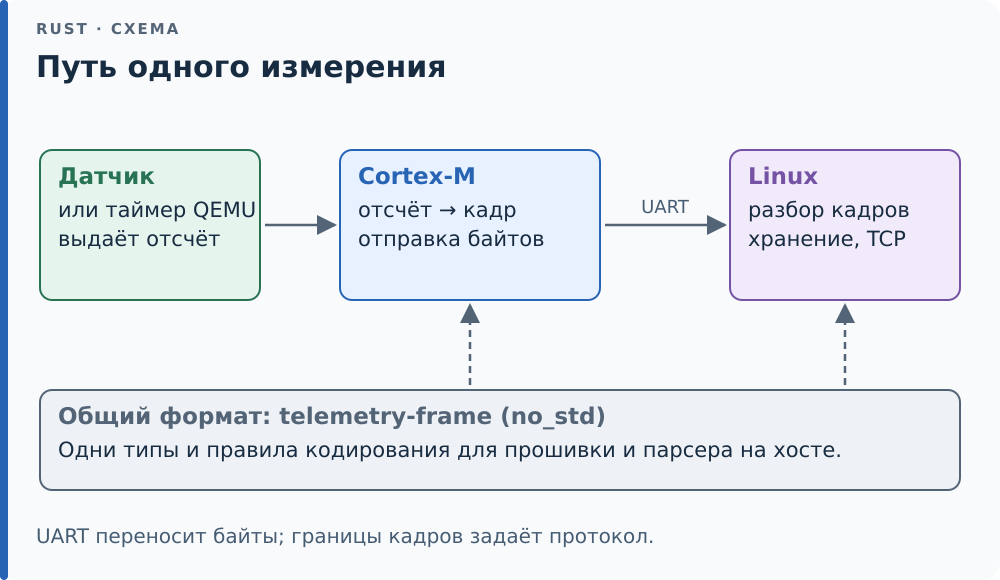

# Сквозной проект: станция телеметрии

Через весь курс студент строит одну систему: прошивка Cortex-M собирает измерения и шлёт кадры по [UART][g-uart], [хост][g-host] на Linux принимает их, хранит и раздаёт по TCP. Каждая часть учебника добавляет компонент, и к главе 31 у студента есть работающая система для профилирования, [фаззинга][g-fuzzing] и защиты. В QEMU измерения генерирует таймер, на плате их даёт АЦП или датчик по I2C.

Формат кадра живёт в одном no_std-крейте, который подключают и кодер на МК, и парсер на хосте.

<div class="diagram">



</div>

*Сплошные стрелки — путь данных; пунктирные — использование общего
формата кадра двумя сторонами системы.*

| После главы | Что добавляется в проект |
|---|---|
| 6 | Формат кадра: заголовок, тип, длина, CRC, порядок байт |
| 7 | Типы ошибок протокола |
| 12–13 | Парсер кадров на [комбинаторах][g-combinator] и [итератор][g-iterator] по потоку байт |
| 15 | Хранилище измерений в памяти хоста и аллокатор-счётчик |
| 18 | C-библиотека для чтения журнала из сторонних программ |
| 21 | [SPSC][g-spsc]-буфер между прерыванием UART и основным циклом прошивки |
| 22 | Асинхронный приём на хосте и TCP-сервер |
| 24–25 | [derive][g-derive] для кадров и проверки [раскладки][g-layout] при компиляции |
| 26–27 | Прошивка целиком: старт, драйверы, прерывания, мини-RTOS или embassy |
| 28 | Журнал на mmap, демон с обработкой сигналов |
| 30–31 | Профилирование, фаззинг протокола, [Kani][g-kani] для буферов |

Код проекта живёт в каталоге `project/` репозитория. Первый шаг, формат кадра, разобран в [разделе 6.11](ch06/11-project.md), второй, ошибки протокола, — в [разделе 7.10](ch07/10-project.md).

## Как проходить проект по частям

Начинайте с шага после главы 6: для него нужен только формат кадра,
а прошивка и сервер появятся позже. В строке таблицы «после главы»
указаны знания для нового шага, а не требование сначала собрать всю
станцию. Готовый код позволяет отдельно проверить уже изученный компонент:

```console
$ cargo test -p telemetry-frame --test frame encode_matches_vectors
$ cargo test -p telemetry-frame --test frame decode_matches_vectors
```

Первый тест сравнивает закодированные байты с заранее рассчитанными,
второй проверяет обратный разбор. Для них не нужны UART, QEMU и сеть.
Свою реализацию этого шага пишите в `exercises/project-frame/`:
`cargo test -p project-frame` запускает проверки заготовки. Полезно
сначала добиться правильного кодирования одного кадра, затем разбора
одного кадра и только потом переходить к потоку и ошибочным входам.

## Один отсчёт: от значения к байтам и обратно

Этот разбор связывает понятия из глав 1–7 с общей схемой станции.
Пусть датчик с номером **7** выдал **−42** через **1000 мс** после старта.
В нашем формате это три целых числа; единица измерения величины `value`
здесь не задаётся. Например, перевод отсчётов в градусы потребовал бы
отдельного правила.

1. Создаём `Measurement`: номер датчика, время и значение.
2. `Measurement::to_bytes` превращает поля в **10 байт нагрузки**.
   Нагрузка — только измерение, без заголовка кадра.
3. `encode` добавляет **8 байт заголовка**: тип измерения, номер кадра 5,
   длину нагрузки и контрольную сумму. Для отправки получаются **18 байт**.
4. На приёме `decode` проверяет заголовок, длину и контрольную сумму,
   затем даёт доступ к нагрузке. `Measurement::from_bytes` разбирает
   её поля обратно. Это два шага: корректный кадр ещё нужно истолковать
   как измерение.

Вот тот же кадр по группам. Все числа в столбце байтов записаны
шестнадцатерично, слева направо в порядке передачи:

| Байты кадра | Что означают | Почему столько байт |
|---|---|---|
| `A5 01 01 05` | Маркер, версия, тип «измерение», номер кадра 5 | Четыре однобайтовых поля |
| `0A 00` | Длина нагрузки 10 | `u16`, младший байт первым |
| `E5 73` | Контрольная сумма CRC `0x73E5` | Ещё одно поле `u16` |
| `07 00` | Номер датчика 7 | `u16` |
| `E8 03 00 00` | Время 1000 мс (`0x000003E8`) | `u32` |
| `D6 FF FF FF` | Значение −42 | `i32`, представление из [1.1](ch01/01-integers.md) |

Этот набор байтов уже есть в `tests-shared/frame.rs` под именем `MEAS`.
Размер структуры в памяти и число передаваемых байтов могут различаться:
на провод идут явно записанные поля, а не копия памяти структуры.
Расчёт CRC разберём в [6.11](ch06/11-project.md); здесь достаточно понять,
какие части кодер добавляет к измерению, а парсер проверяет и отделяет.

<details>
<summary>Проверьте себя: пришло только 11 байт этого кадра. Что известно?</summary>

Восемь байт заголовка уже есть: из поля длины известно, что нужно
ещё десять байт нагрузки. Пока получено только три её байта, семи не
хватает. `decode` вернёт `FrameError::Short { need: 18, have: 11 }`.
Это ещё не повод объявлять кадр повреждённым: приёмник может дождаться
остальных байтов, как объясняет [7.10](ch07/10-project.md). Числа 18 и 11
считают весь кадр, а не только нагрузку.

</details>

<!-- Ссылки на глоссарий (приложение F); обновляет tools/check-terms.py --refs -->
[g-combinator]: appendix-f.md#combinator "Комбинатор (combinator): Метод или функция, которая строит новое вычисление из готовых, не разбирая значение вручную: map, and_then, ok_or у Option и Result, адаптеры итераторов, all, any и not в условиях cfg."
[g-derive]: appendix-f.md#derive "derive (derive macro): Атрибут #[derive(...)] над типом: макрос получает объявление структуры, перечисления или объединения и добавляет рядом реализации трейтов — Debug, Clone, PartialEq."
[g-fuzzing]: appendix-f.md#fuzzing "Фаззинг (fuzzing): Проверка программы потоком порождённых входов в поисках падения."
[g-host]: appendix-f.md#host "Хост (host): Машина, на которой идёт сборка и работают инструменты, в отличие от цели, под которую собирается код."
[g-iterator]: appendix-f.md#iterator "Итератор (iterator): Тип, реализующий трейт Iterator: состояние обхода с методом next, который выдаёт следующий элемент или None."
[g-kani]: appendix-f.md#kani "Kani: Проверяльщик моделей для Rust, подключаемый к cargo: cargo kani компилирует крейт своим драйвером rustc в программу для CBMC и проверяет её сразу для всех значений символьных входов kani::any()."
[g-layout]: appendix-f.md#layout "Раскладка (layout): Размер, выравнивание и смещения полей типа в памяти."
[g-spsc]: appendix-f.md#spsc "SPSC (single-producer single-consumer): Очередь с одним писателем и одним читателем."
[g-uart]: appendix-f.md#uart "UART (Universal Asynchronous Receiver-Transmitter): Последовательный порт: передаёт байты по линии бит за битом без общего тактового сигнала."
